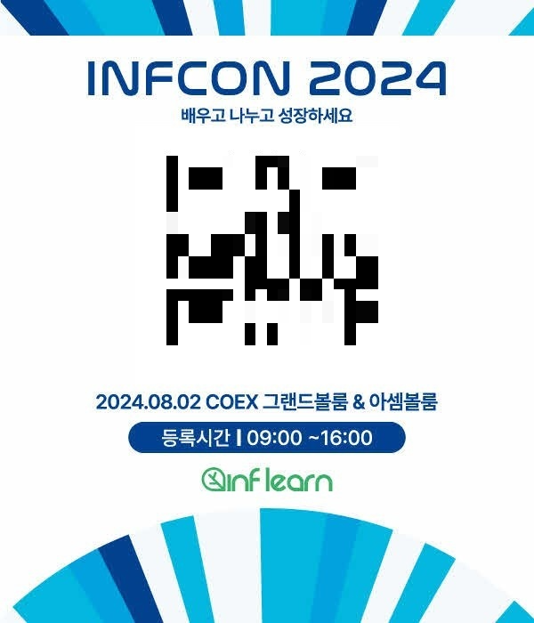
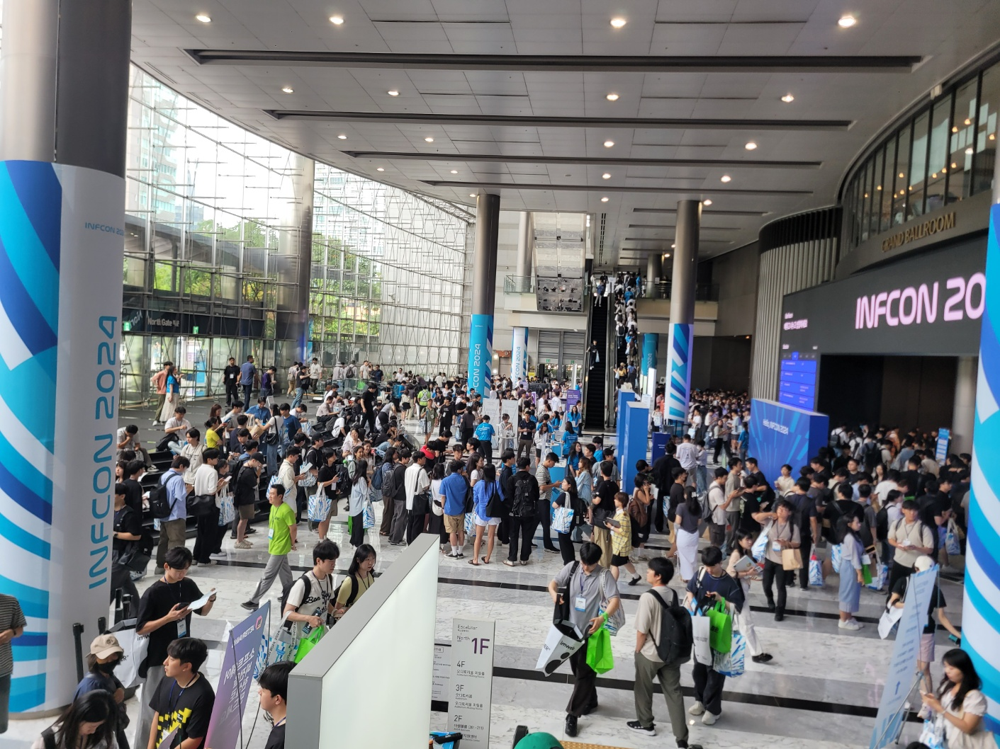

추첨 운이 없는 편이라 이런 거는 신청도 잘 안 하는데, 운 좋게도 회사에서 참가권을 받아서 참가하게 되었다. (번개장터 짱👍)

두근거리는 마음으로 코엑스에 도착했는데 예상한것보다 사람이 정말 정말 많았다.

사람이 너무 많으니까 발표장 찾아가는것도 일이었다..😅

아무튼 이번 인프콘에서 가장 기억에 남는 세션은 '혹시 당신은 데이터를 모르는 백엔드 개발자 인가요?'랑 '난생처음 만드는 Vite 플러그인' 이었다.

일단 '난생처음 만드는 Vite 플러그인'은 예전에 자바스크립트 강의를 들으면서 많은 도움이 되었던 이은재 님의 발표였는데, 강의 때처럼 Vite 플러그인을 만드는 단계를 처음부터 쉽게 차근차근 소개해주었다.

어렵고 복잡할 수도 있는 내용인데 이해하기 쉽게 설명해 주시는 게 정말 대단하다고 느껴졌다.

이해의 깊이가 얼마나 깊으면 저렇게 설명할 수 있을까, 존경스러웠다. (그리고 항상 화면으로만 봤다 보니 연예인 보는 느낌이었다ㅎㅎ)

그리고 세션이 끝난 후 QnA 시간에 참여했는데, 그때도 질문들에 친절하고 성심성의껏 답변해 주셔서 참 감사했다.

'혹시 당신은 데이터를 모르는 백엔드 개발자 인가요?'는 백엔드, 데이터 둘 다 내가 잘 모르는 분야라서 한번 들어보자! 싶어서 참여했는데 생각보다 내용이 흥미로웠다.

발표자는 아임웹에서 백엔드/데이터 엔지니어로 계시는 김지호 님이었다.

일단 두 분야를 같이 겸하고 있는 것도 신기했지만, 같은 데이터베이스여도 백엔드와 데이터 엔지니어가 바라보는 관점이 다를 수 있다는 게 신기했다.

데이터베이스의 행 vs 열을 비교하며 어떤 차이가 있는지 설명해 주셨는데, 발표 내용처럼 나도 예전에 백엔드 개발자로서 DB를 대할 때 행에만 관심이 있었지 이 데이터들을 누군가 분석하는 데 사용할 거라는 생각은 전혀 안 했던 기억이 났다.

이 내용을 알고 있었다면 전에 그렇게 DB를 사용하지 않았겠구나.. 하는 생각도 들었고 여러모로 재밌었던 시간이었다.

시간이 겹쳐서 듣지 못했던 세션들은 나중에 영상으로 올라오면 꼭 봐야겠다. 왜 듣고 싶은 세션은 한 시간대에 몰려 있는 건지 😂

\+ 이날 많은 인파에 기를 너무 빨렸는지 집에 와서 19시부터 다음날 19시까지 총 24시간 동안 숙면하고 일어났다..... 힘들기도 했지만 아주 보람찬 시간이었다.

이번에는 발표 듣고 QnA에 참여하느라 빼먹었는데, 다음번에도 기회가 된다면 네트워크 파티에도 참여해도 재밌을 것 같다.

그럼 짧은 참가 후기 끝!
