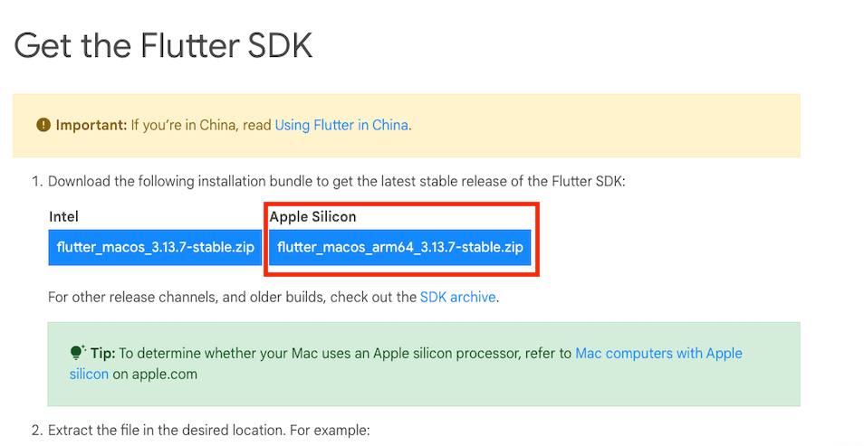
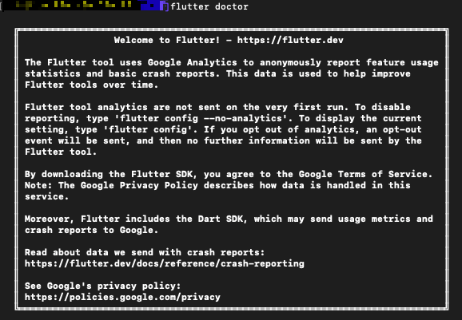
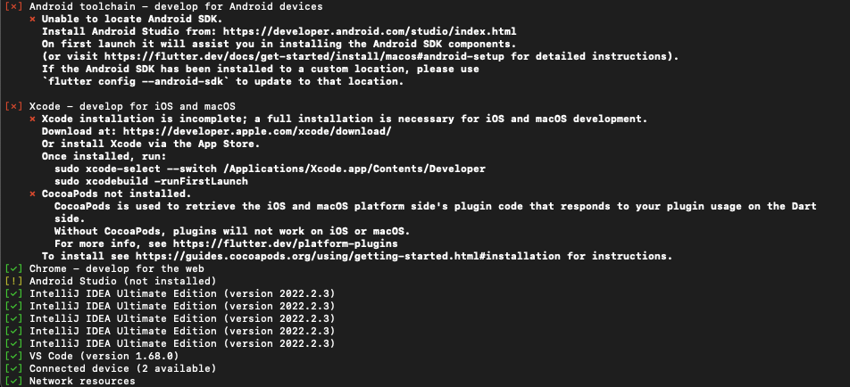

### 1\. Flutter 공식 문서에서 SDK 를 설치한다.

[https://docs.flutter.dev/get-started/install/macos](https://docs.flutter.dev/get-started/install/macos)



### 2\. Downloads 에 받은 압축폴더의 압축을 해제한다.


참고로 나는 downloads -> documents로 폴더를 이동했다.

### 3\. 터미널에서 bash\_profile을 연다.

```bash
nano .bash_profile
```

위 명령어를 터미널에 붙여넣으면 자동으로 텍스트를 수정할 수 있는 파일이 열린다.

### 4\. bash\_profile에 다음 내용을 추가하여 PATH 를 갱신한다.

```bash
export PATH=$HOME/flutter/bin:$PATH
```

혹은

```bash
export PATH=$PATH:Downloads/flutter/bin
```

\* 터미널에서 bash\_profile 을 열면 아래에 명령어들이 나온다. 명령어를 참고해서 파일을 수정하자.

### 5\. 파일을 새로고침한다.

```shell
source ~/.bash_profile
```

### 6\. 터미널에서 flutter doctor 를 실행해서 설치가 잘 되었는지 확인한다.

```shell
flutter doctor
```

아래 내용이 터미널에 출력되면 flutter는 정상적으로 설치된 것이다.



위 화면의 아래 부분에 나오는것처럼 \[ x \] 인 항목들은 설치를 해주어야 한다.



\==============================================

위 방법을 해도 환경 변수 설정이 안되는 경우가 있다.

그럴 때는 아래 방법을 시도해 보자.

#### **1\. 터미널에서 아래 명령어를 입력한다.**

> open ~/.zshrc

그럼 텍스트 편집기가 뜬다.

#### **2\. 환경 변수를 설정한다.**

```bash
export PATH="$PATH:플러터SDK폴더경로/bin"
```

"플러터SDK폴더경로" 부분에 폴더가 있는 경로를 적어주면 된다.

이 문장을 1번에서 뜬 창 아래에 붙여 넣기 하자.

\* 폴더 경로 확인하는 방법:

터미널에서 cd 명령어로 해당 경로로 이동한 뒤, 터미널에 **pwd** 를 입력하면 전체 경로가 나온다.
