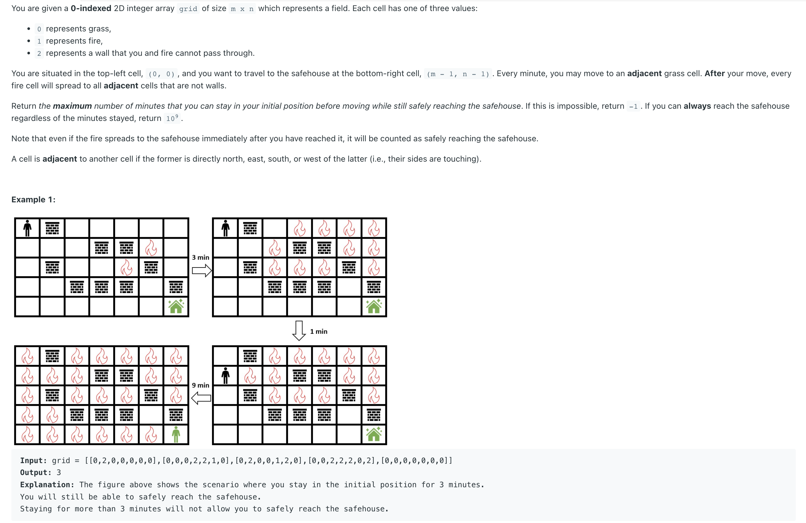

[https://leetcode.com/problems/escape-the-spreading-fire/](https://leetcode.com/problems/escape-the-spreading-fire/)

[Escape the Spreading Fire - LeetCode](https://leetcode.com/problems/escape-the-spreading-fire/)



불이 1초마다 사방으로 퍼지는데 불에 타지 않고 도착지까지 간다고 할 수 있을 때, 시작위치에서 최대로 머무를 수 있는 시간을 구하는 문제이다.

크게 두 단계로 나눠서 진행해야 한다.

1단계는 불이 근원지부터 모든 셀에 퍼지는데 걸리는 시간을 grid에 기록하고 2단계는 (0,0)부터 도착위치까지 가면서 최대로 버틸 수 있는 시간을 기록한다.

먼저 1단계인 불이 퍼지는 시간을 구하기 위해서 다익스트라 알고리즘을 사용했다.

모든 칸에 정보를 다 채웠다면 다음 단계로 넘어간다.

2단계가 문제인데, 생각해야 할 점이 내가 다음 칸에 도착하는것과 동시에 그곳에 불이 번진다면 그 위치로는 이동할 수 없지만 이동하는 그 위치가 도착지라면 불과 동시에 도착해도 성공으로 본다는 것이다.

이때문에 2단계는 BFS 알고리즘을 사용하되 다음에 갈 곳이 마지막이라면 대기할 수 있는 시간을 다른 곳들보다 +1 해준다.

어떤 위치로 올 수 있는 사방을 체크했을 때 그 네곳중에서 현재 위치로 오기위해 대기해야 하는 최대 시간을 저장해야 하고 내가 도착지로 가는 루트중에서는 최소 시간을 저장해야 한다.

이 문제는 예외 처리도 생각해야 할 게 많고 코드 자체도 길어질 수 밖에 없어서 잘 생각하고 풀어야 하는 문제였다.

```python
class Solution:
    def maximumMinutes(self, originGrid: List[List[int]]) -> int:
        MAX_VALUE = 1000000000
        fires = []
        grid = []
        m, n = len(originGrid), len(originGrid[0])
        visited = [[False] * n for _ in range(m)]

        # 1. 다익스트라로 각 그리드에 불이 퍼지는 최소 시간 구하기
        for i in range(m):
            temp = []
            for j in range(n):
                if originGrid[i][j] == 1:
                    fires.append((0,i,j))
                    temp.append(0)
                elif originGrid[i][j] == 0:
                    temp.append(float('inf'))
                elif originGrid[i][j] == 2:
                    temp.append('/')  # / : 벽   ,  . : 방문
            grid.append(temp)

        while fires:
            fire = heapq.heappop(fires)
            time, r, c = fire[0], fire[1], fire[2]
            if 0<=r and r<m and 0<=c and c<n and grid[r][c]!='.' and grid[r][c]!='/' and not visited[r][c]:
                grid[r][c] = min(grid[r][c], time)
                heapq.heappush(fires, (time+1, r, c+1))
                heapq.heappush(fires, (time+1, r+1, c))
                heapq.heappush(fires, (time+1, r, c-1))
                heapq.heappush(fires, (time+1, r-1, c))
                visited[r][c] = True

        # print(grid)

        # 2. 출구까지 가면서
        #    그 루트에 불이 퍼지는 시간과 그 장소까지 가는데 걸린 시간을 이용해
        #    최대 기다릴 수 있는 시간 구하기
        memo = [[-1]*n for _ in range(m)]
        times = 1
        q = []
        if 0<=grid[0][0]:
            memo[0][0] = grid[0][0]-1
        else:
            memo[0][0] = MAX_VALUE

        heapq.heappush(q, (memo[0][0],0,0))

        while q:
            temp = []
            for _ in range(len(q), 0, -1):  # 추가되는애들 말고 현재 있는 큐만 일단 검사하기 위해(한번 돌때마다 times 증가)
                curr = heapq.heappop(q)
                delay, r, c = curr[0], curr[1], curr[2]
                for row, col in [[r,c+1],[r+1,c],[r,c-1],[r-1,c]]:
                    if 0<=row and row<m and 0<=col and col<n and grid[row][col]!='/':
                        isNotSafeHouse = row != m-1 or col != n-1  # safe house면 불 만나도 집에 들어가면 되니까 1초의 추가 여유 주기 위해
                        if 0 <= grid[row][col]:
                            maxPossibleDelay = grid[row][col] - times - int(isNotSafeHouse)
                        else:
                            maxPossibleDelay = MAX_VALUE
                        nextDelay = min(delay, maxPossibleDelay)
                        visited = 0<=memo[row][col]

                        if nextDelay<0 or (visited and nextDelay <= memo[row][col]):
                            continue
                        memo[row][col] = nextDelay
                        # q.append((nextDelay, row, col))  # 힙푸시 안하는 이유: 위에서 for문으로 q동안 돌도록 하는데 히힙푸시하면 순서가 바껴버린다!
                        heapq.heappush(temp, (nextDelay, row, col))
            q = temp[:]
            times += 1

        # print(memo)

        return memo[-1][-1] if memo[-1][-1] != float('inf') else MAX_VALUE
```
