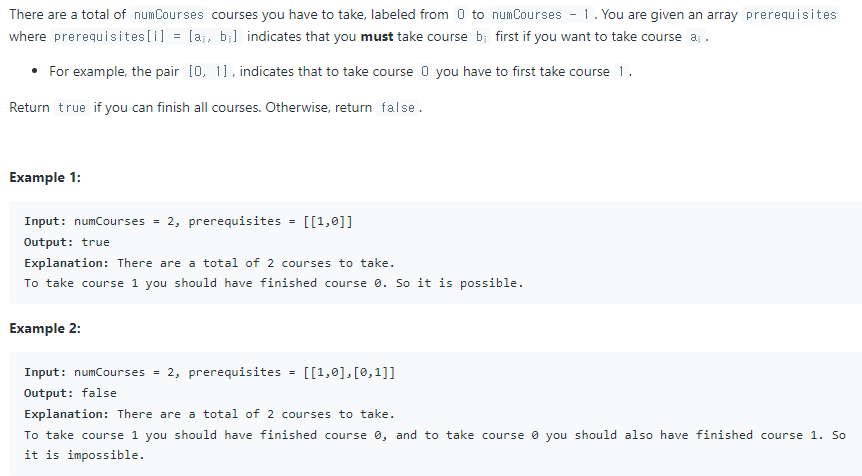

[https://leetcode.com/problems/course-schedule/](https://leetcode.com/problems/course-schedule/)

[Course Schedule - LeetCode](https://leetcode.com/problems/course-schedule/)



prerequisites의 \[0\]의 값을 갖기 위해서는 \[1\]값을 먼저 얻어야 하는 BFS문제이다.

전형적인 BFS문제대로 풀었다.

①

\[0\]의 값을 키로 딕셔너리(python) 혹은 맵(JS)를 만들어서 해당 값을 얻기 위해 먼저 얻어야 하는 목록들을 value로 저장해둔다.

②

numCourses-1만큼을 얻어야 하기 때문에 0~numCourses-1의 범위를 모두 확인해서 모든 값들이 BFS를 통과하는지 보면 된다.

③

BFS는 cycle이 없어야 통과하도록 코드를 짤 것이다.

이는 visited 배열을 만들어서 값들을 방문할 때마다 저장해 둔 뒤 중복되는 값이 있는지 확인해주면 된다.

④

BFS함수 바깥에 checked 배열을 만들고 해당 key값의 모든 value를 확인하여 다 true를 얻었을 경우에만 여기에 저장한다.

⑤

고로 정리하자면 BFS에서는 매개변수로 받는 key가 visited에 있으면 false를, checked에 있으면 true를 바로 반환해준다.

또, 딕셔너리의 모든 value들이 BFS를 통과했다면 checked에 추가해주고 true를 리턴한다.

&lt;python>

```python
class Solution:
    def canFinish(self, numCourses: int, prerequisites: List[List[int]]) -> bool:
        # cycle이 있으면 무조건 F이다.
        # cycle이 하나라도 있는지 확인해야함

        def dfs(key, visited):
            if key in visited: return False  # 확인중인 목록에 있으면 cycle일수밖에
            if key in checked: return True  # 완전 확인끝난 애들에 포함되어있다면 얜 안전. 확인할필요 X

            if key in pre:
                for val in pre[key]:
                    if not dfs(val, visited+[key]): return False

            checked.append(key)  # 위 for문에서 중단당하지 않았다면 얜 안전!
            return True

        pre = {}  # 딕셔너리로 짝지을거. key를 얻으려면 [val]에 있는애들 먼저해야함
        checked = []  # 전부 다 봐서 cycle없는거 확인 끝마친 애들

        for p in prerequisites:
            if p[0] in pre: pre[p[0]].append(p[1])
            else: pre[p[0]] = [p[1]]

        # numCourses-1 까지 전부 통과해야 최종적으로 T를 리턴할 수 있음. 그러니 하나씩 다 검사
        for i in range(numCourses):
            if not dfs(i, []): return False  # 하나라도 F면 즉시 리턴

        return True
```

&lt;JavaScript>

```javascript
var canFinish = function(numCourses, prerequisites) {
    const bfs=(key, visited)=>{
        if(visited.includes(key)) return false;  // 지금 검사중인 목록에 있으면 cycle임.
        if(checked.includes(key)) return true;  // 검사 끝난 목록에 있으면 어차피 true임

        // key에 해당하는 값 다 확인해서
        // 하나라도 f 면 바로 리턴
        if(map.get(key)!==undefined){
            for(const val of [...map.get(key)]){
                if(!bfs(val, [...visited, key])) return false;
            }
        }

        // 위 단계 전부 통과했으면 얘(key)는 안전한애
        checked.push(key);
        return true;
    }

    const checked = [];  // 완벽히 끝까지 체크한 애들
    const map = new Map();  // [0]을 하기위해 [1]에있는 배열을 다 만족해야 함. 이걸 여기에 정리할거임

    for(const p of prerequisites){
        // map.set(p[0], map.get(p[0]) ? [map.get(p[0])]+[p[1]] : p[1] );
        if(map.has(p[0])){
            map.set(p[0], [...map.get(p[0]), p[1]]);
        }else{
            map.set(p[0], [p[1]]);
        }
    }

    // numCourses-1 만큼은 다 검사해서, 하나라도 F면 안됨
    for(let i=0; i<numCourses; i++){
        if(!bfs(i, [])) return false;
    }

    return true;
};
```
