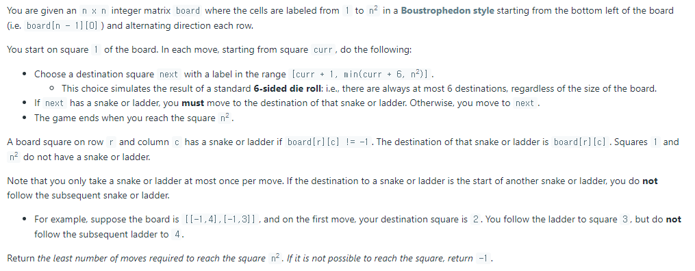
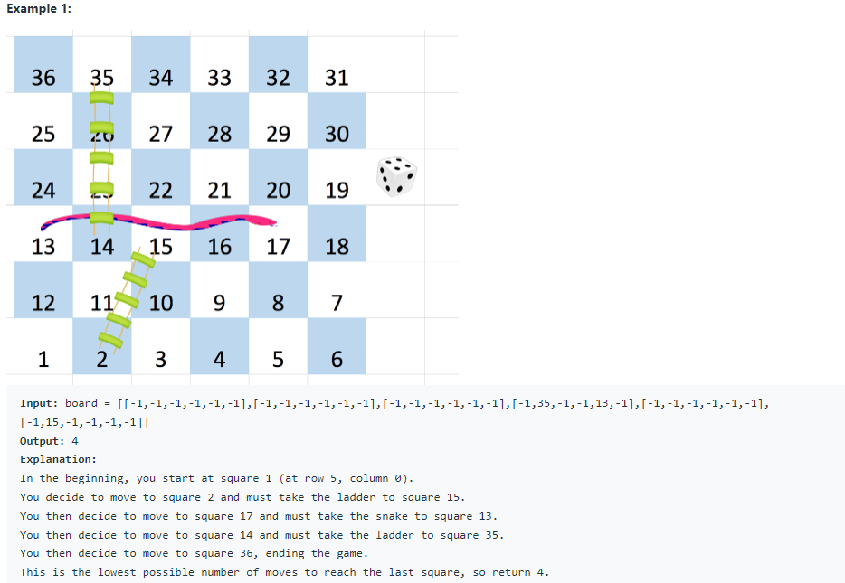

[https://leetcode.com/problems/snakes-and-ladders/](https://leetcode.com/problems/snakes-and-ladders/)

[Snakes and Ladders - LeetCode](https://leetcode.com/problems/snakes-and-ladders/)





이 문제의 포인트는 두 가지로 요약할 수 있다.

1\. 각 칸에 붙여진 번호를 이용해 좌표를 구하는 것

2\. ladder 또는 snake를 만났을 때 해당 위치로 바로 이동하는 게 하나의 과정이라는 것

먼저 좌표를 구하는 함수를 따로 만들어서 현재 칸 번호를 주면 row, col을 되돌려주도록 작성한다.

맨 밑줄은 column이 왼->오 방향이지만 그 윗줄은 오->왼 방향으로 하나 걸러 하나씩 column의 방향이 다르다.

이것은 칸 번호를 board의 length로 나눠주어 구할 수 있다.

row가 짝수인 경우와 홀수인 경우를 번갈아가며 column을 \[0\]부터 시작할 지시작할지 \[-1\]부터 시작할지 결정한다.

이제 말판을 이동할건데 큐를 만들어서 여기에 앞으로 탐색할 위치를 넣어둘 것이다.

맨 처음에는 시작 위치의 번호인 1을 넣어주고 시작한다.

그다음에는 같은 step끼리 비교해서 도착 위치에 갈 수 있는지 비교해 야하기 때문에 for문으로 동일한 step에서 갈 수 있는 모든 위치가 담긴 q를 검사해준다.

임시 배열을 만들어 이곳에 현재 위치들에서 갈 수 있는 곳들을 모두 저장해 줄 것이다.

만약 board\[row\]\[col\]이 ladder이거나 snake라면 board에 적혀있는 위치로 바로 이동할 수 있기 때문에 이런 경우는 움직이고 난 후로 위치를 갱신한다.

visited를 이용해서 방문한 곳은 겹쳐서 방문하지 않도록 해준다.

끝 위치에 다다랐다면 현재 step을 리턴해주면 된다.

&lt;Python>

```python
class Solution:
    def snakesAndLadders(self, board: List[List[int]]) -> int:
        # 칸 번호 받아서 좌표를 리턴해주는 함수
        def getCoordinate(pos):
            r, c = divmod(pos-1, n)  # 좌표별 라벨이 1베이스라서 인덱스 구하기 위해 pos에서 1뺌
            c = (n-1)-c if r%2==1 else c  # 몫이 짝수인 경우와 홀수인 경우 col이 어디서 시작하는지 달라서 따로 처리
            r = (n-1)-r
            return r, c

        n = len(board)
        q = [1]
        visited = set()
        step = 0

        while q:
            temp = []
            for curr in q:
                row, col = getCoordinate(curr)
                if board[row][col] != -1:  # 있는곳이 뱀이나 사다리라면?
                    curr = board[row][col]  # 해당위치로 이동
                if curr == n*n: return step  # 끝에 다다르면 리턴
                for i in range(1, 7):
                    nexts = curr + i
                    if nexts <= n*n and nexts not in visited:
                        temp.append(nexts)
                        visited.add(nexts)
            step += 1
            q = temp[:]

        return -1
```
