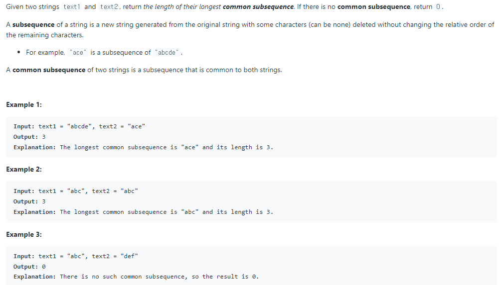

[https://leetcode.com/problems/longest-common-subsequence/](https://leetcode.com/problems/longest-common-subsequence/)

[Longest Common Subsequence - LeetCode](https://leetcode.com/problems/longest-common-subsequence/)



알고리즘의 전형적인 LCA문제 그 자체이다.

이 문제는 top-down 방식과 bottom-up 방식 두 가지로 풀어보았다.

&lt;top-down>

```python
class Solution:
    def longestCommonSubsequence(self, text1: str, text2: str) -> int:
        memo = {}
        n, m = len(text1), len(text2)

        def top_down(i, j):
            if (i, j) in memo:
                return memo[(i, j)]
            if i>=n or j>=m:
                return 0
            if text1[i] == text2[j]:
                return top_down(i+1, j+1) + 1
            memo[(i, j)] = max(top_down(i, j+1), top_down(i+1, j))
            return memo[(i, j)]

        return top_down(0, 0)
```

&lt;bottom-up>

```python
class Solution:
    def longestCommonSubsequence(self, text1: str, text2: str) -> int:
        n, m = len(text1), len(text2)
        dp = [[0]*(m+1) for _ in range(n+1)]

        for i in range(n):
            for j in range(m):
                if text1[i] == text2[j]:
                    dp[i+1][j+1] = dp[i][j] + 1
                else:
                    dp[i+1][j+1] = max(dp[i][j+1], dp[i+1][j])

        return dp[-1][-1]
```
