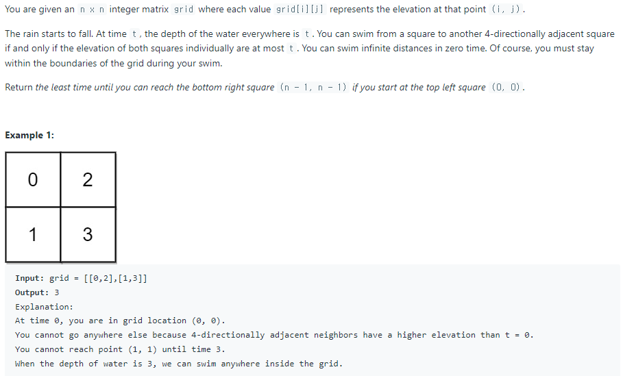
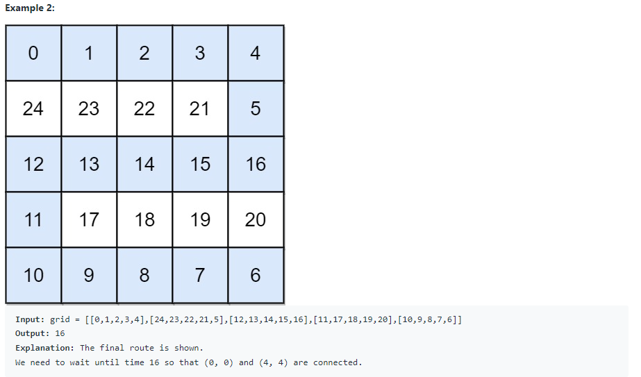

[https://leetcode.com/problems/swim-in-rising-water/](https://leetcode.com/problems/swim-in-rising-water/)

[Swim in Rising Water - LeetCode](https://leetcode.com/problems/swim-in-rising-water/)





이 문제는 DFS문제인데 다익스트라 알고리즘을 사용해서 풀 수도 있다.

파이썬은 heapq 메서드가 있어서 우선순위 큐를 구현하기 쉽기 때문에 파이썬으로는 다익스트라 알고리즘을 적용해서 풀었고 자바스크립트는 DFS로 풀었다.

\[다익스트라\]

다익스트라 알고리즘은 이 문제처럼 각 지점 간 최소거리를 구할 때 사용하기 좋다.

이 문제는 이걸 응용한 문제로 시작 지점부터 도착 지점까지 가는 루트 동안 만나는 최대 숫자가 가장 작은 경우를 구하면 된다.

memo는 inf로 초기화하여 가장 큰 값을 가지고 있는다.

visited는 한 지점에서 갈 수 있는 4 방향을 다 검사하고 나면 저장할 것이다.

stack은 검사할 값이 저장되어 있는데 (i, j, k)로 구성되어 있다. i는 해당 위치로 넘어오기 직전의 값이고 j와 k는 검사할 곳의 좌표를 뜻한다. 우선순위 큐로 구현할 것이고 stack이 빌 때까지 계속해서 검사를 진행할 것이다.

본격적으로 while문에 진입하여 heapq로 stack에서 이전 값이 가장 적은 순서대로 값을 꺼낸다.

꺼낸 값의 사방을 체크하여 검사할 위치의 값(grid\[row\]\[col\])과 이전 값 중 더 큰 값을 고르고, 그 값과 memo에 저장된 값을 또 비교하여 작은 값을 선택하여 저장한다.

이 이유를 간단하게 설명하면 memo에 저장할 값은 일단 지금까지의 루트 중에 가장 큰 값이어야 하기 때문에 max(grid\[row\]\[col\], 이전 값(루트 중 최솟값))을 해주는 것이고 또 여러 가지 경우의 루트 중에서는 이 값이 가장 작은 경우를 택해야 하기 때문에 memo\[row\]\[col\]값과 비교를 해주는 것이다.

사방을 다 체크했다면 visited는 True로 바꿔주고 모든 곳을 다 체크할 때까지 (stack이 빌 때까지) 검사한다.

이렇게 되면 도착 지점에는 결국 우리가 찾는 답이 저장될 것이다.

&lt;Python>

```python
class Solution:
    def swimInWater(self, grid: List[List[int]]) -> int:
        n = len(grid)
        memo = [[float('inf')] * n for _ in range(n)]  # 처음엔 inf 값으로 초기화
        visited = [[False] * n for _ in range(n)]
        stack = [(0,0,0)]  # (0,0)=현재위치랑 이전값
        dirs = [[-1,0], [0,-1], [0,1],[1,0]]

        while stack:
            val = heapq.heappop(stack)
            row, col = val[1], val[2]
            if 0<=row<n and 0<=col<n and visited[row][col]==False:
                for r, c in dirs:
                    # (이전값, 현grid) 중 max를, 메모돼있는(처음엔 inf값인) 값과 비교해서 min값을 메모함
                    memo[row][col] = min(memo[row][col], max(grid[row][col], val[0]))
                    heapq.heappush(stack, (memo[row][col],row+r,col+c) )
                visited[row][col] = True

        return memo[-1][-1]
```

\[DFS\]

자바스크립트는 내장된 큐 자료구조가 없어서 구현이 복잡해지기 때문에 다익스트라 알고리즘을 사용하지 않았다.

자바스크립트로 푼 DFS는 먼저 각 칸에 고유 번호를 붙인다.

3X3의 그리드라면 첫 줄은 0,1,2이고 두 번째 줄은 3,4,5의 방식으로 번호를 붙일 것이고 이는 row\*n+col으로 구할 수 있다.

visited는 set 자료구조로 관리하는데 여기의 모든 값을 제거해야 하는 경우가 매 반복문마다 있기 때문에 배열로 관리하면 시간 초과가 나게 되기 때문이다.

while문은 visited에 도착지점이 포함될 때까지 실행한다.

time을 1씩 증가시켜가며 DFS함수를 실행할 것이다.

DFS에서는 grid\[row\]\[col\]의 값이 현재의 time보다 크다면 함수를 빠져나가서 time을 증가시키게 된다.

이렇게 하면 결국 time을 최소로 증가시키면서 도착 지점에 도달할 수 있게 된다.

&lt;JavaScript>

```javascript
/**
 * @param {number[][]} grid
 * @return {number}
 */
var swimInWater = function(grid) {
    const visited = new Set();
    let time = 0;
    let n = grid.length;

    // 각 칸마다 번호를 붙여서
    // 그 칸의 값이 적어도 time보다 작다면 수영가능
    // 값이 time보다 크다면 time을 1씩 늘려가면서 끝까지 갈 수 있을때까지 검사
    const dfs =(row, col)=>{
        if(0<=row && row<n && 0<=col && col<n && !visited.has(row*n+col) && grid[row][col] <= time){
            visited.add(row*n+col);
            for(const [r, c] of [[0,1],[1,0],[0,-1],[-1,0]]){
                dfs(row+r, col+c);
            }
        }
        return
    }

    while(!visited.has(n*n-1)){
        visited.clear();
        dfs(0,0);
        time ++;
    }

    return time-1;
};
```
