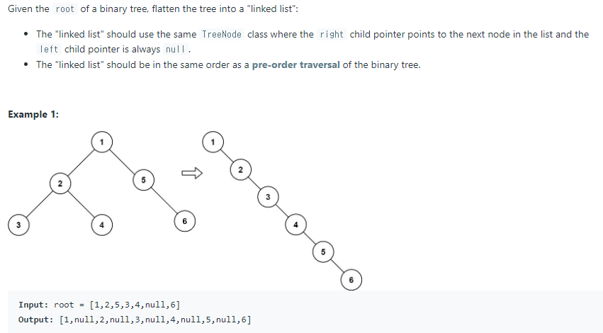

[https://leetcode.com/problems/flatten-binary-tree-to-linked-list/](https://leetcode.com/problems/flatten-binary-tree-to-linked-list/)

[Flatten Binary Tree to Linked List - LeetCode](https://leetcode.com/problems/flatten-binary-tree-to-linked-list/)



root를 전위 순회하여 모든 노드를 오른쪽으로 배치하는 문제이다.

재귀로 푸는 방법과 morris traversal 알고리즘을 사용하는 방식 두 가지로 풀어보았다.

\[방법 1: recursion\]

왼쪽과 오른쪽으로 나누어서 각 부분을 재귀 함수로 flatten 하는 방법이다.

재귀 함수 바깥의 head에 모아 온 노드들을 저장해준다.

이는 재귀 함수는 가장 끝에 있는 노드부터 구하게 될 것이기 때문에 현재 구한 정답을 임시로 저장해두기 위한 포인터이다.

\[1,2,5,3,4,6,7\]로 주어졌을 때​ 정답에서 가장 마지막 부분에 위치할 7이 가장 먼저 head에 저장되고 그다음은 6,7이 그다음은 5,6,7이 저장되는 방식이다.

dp처럼 메모이제이션을 한다고 생각하면 된다.

```javascript
var flatten = function(root) {
    let head = null;  // 오른쪽에 붙는 노드를 저장할 포인터. 지금까지 모은 오른쪽노드들
    const recursion=(root)=>{
        if(root.right) recursion(root.right);
        if(root.left) recursion(root.left);
        root.left = null;  // 왼편 비우고
        root.right = head;  // 오른편엔 지금까지 모은 노드를 붙여준다.
        head = root;  // root를 갱신했으니 head도 갱신

    }
    if(root) recursion(root)
};
```

\[방법 2: Morris Traversal\]

모든 노드를 오른쪽으로 이동시킬 것이기 때문에 root를 오른쪽으로 이동해나가면서 왼쪽에 노드가 존재할 때 이 노드를 오른편으로 붙여주는 방법이다.

왼쪽에 있는 노드를 오른쪽으로 이동시켰을 때 원래 있던 오른쪽 노드들은 방금 이동시킨 왼쪽 노드의 가장 오른쪽으로 위치시켜야 한다.

이를 위해 포인터를 하나 만들고 가장 오른쪽을 가리키도록 만든다.

현재 노드 왼편의 가장 오른쪽에다 현재 오른편의 노드를 붙여준 뒤 이것을 현재의 오른편에 다시 이어 붙여준다.

```javascript
var flatten = function(root) {
    let curr = root;
    while(curr){
        if(curr.left){
            // 왼쪽 노드들의 가장 오른쪽에 현재node오른쪽 부분을 이어붙여야 하기 때문에 포인터 이동
            let l = curr.left;
            while(l.right) l = l.right;

            l.right = curr.right;  // 현재노드의 왼편중에서 가장 오른쪽에다가 현재오른노드를 붙여준다.
            curr.right = curr.left;  // 왼쪽노드를 오른쪽으로 이동
            curr.left = null;  // 왼쪽 비우기
        }
        curr = curr.right;  // 계속 오른쪽으로 넘어가면서 탐색. 왼쪽노드가 있을때마다 위의 루프 실행예정
    }
};
```
