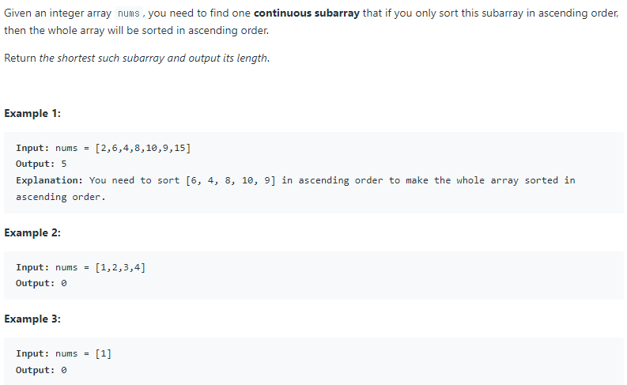

[https://leetcode.com/problems/shortest-unsorted-continuous-subarray/](https://leetcode.com/problems/shortest-unsorted-continuous-subarray/)

[Shortest Unsorted Continuous Subarray - LeetCode](https://leetcode.com/problems/shortest-unsorted-continuous-subarray/)



정렬해야 하는 제일 앞 인덱스와 제일 끝 인덱스를 찾아주면 된다.

start와 end 두 가지 변수를 사용해서 start에는 \[start\] > \[start+1\]가 되는 지점을 찾고 end는 반대를 찾아서 변수에 저장해준다.

여기까지 하면 어떤 테스트 케이스는 통과할 수 있지만 전체 테스트 케이스를 통과하지는 못한다.

\[2,3,3,2,4\] 같은 경우 때문인데 위의 과정까지만 하고 끝내면 \[2:3\]의 범위만 잡게 된다.

하지만 첫 번째 3인 \[1\]까지도 정렬 필요 범위에 포함시켜야 한다.

그래서 일단 지금까지 구한 범위중에서 최솟값과 최고값을 구해서 현재 범위의 앞부분에 최솟값보다 큰 숫자가 있다면 그 숫자도 범위에 포함시켜 준다.

최댓값도 마찬가지로 진행하면 원하는 값을 얻을 수 있다.

```python
class Solution:
    def findUnsortedSubarray(self, nums: List[int]) -> int:
        start, end = 0, len(nums)

        # sort해야하는 제일 앞 인덱스랑 제일 끝 인덱스 찾기
        for i in range(len(nums)-1):
            if nums[i] > nums[i+1]:
                start = i
                break

        for i in range(len(nums)-1, start, -1):
            if nums[i-1] > nums[i]:
                end = i
                break

        # 정렬할거없으면 리턴
        if start == 0 and end == len(nums): return 0

        haveToSort = nums[start:end+1]
        minNum = min(haveToSort)
        maxNum = max(haveToSort)

        while 0<start and minNum<nums[start-1]: start -= 1
        while end<len(nums)-1 and nums[end+1]<maxNum: end += 1

        return end-start+1
```
