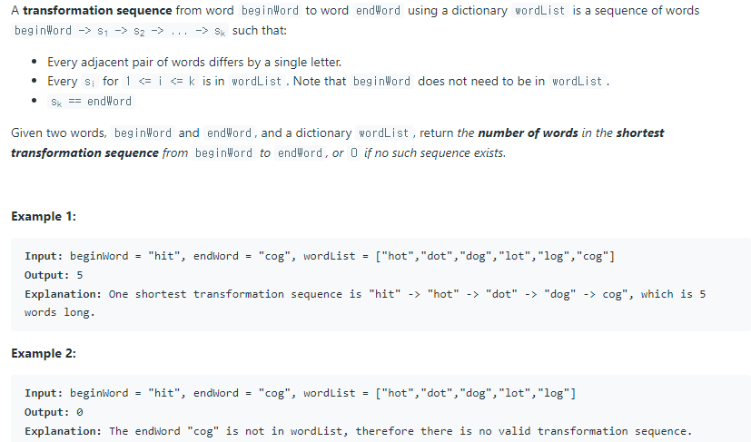

[https://leetcode.com/problems/word-ladder/](https://leetcode.com/problems/word-ladder/)

[Word Ladder - LeetCode](https://leetcode.com/problems/word-ladder/)



처음에는 이 문제를 재귀로 풀려고 했었는데 메모리를 초과하는 문제가 있어서 잘못된 방법이란 걸 알게 되었다.

자료구조로 딕셔너리와 큐를 사용하였다.

딕셔너리에 wordList의 모든 단어들을 한 글자씩 \*로 바꾼걸 키로 하여 밸류를 리스트로 추가해준다.

ex) &amp;#123;\*ot:'hot', 'dot', lot'&amp;#125;

beginWord를 큐에 담아서 앞에서부터 하나씩 꺼내면서 검사할 건데 큐에 넣을 때 level이란 걸 같이 담을 것이다.
level은 현재 몇 번째 체인이 걸렸는지 저장하는 값

while문 안에서 큐에서 꺼낸 값을
처음에 한 것처럼 각 문자 하나씩을 \*로 바꿔서, 이걸 키로 딕셔너리에서 값을 가져온다.

그러면 큐에서 꺼낸 단어를 \*로 바꾼 단어와 동일한 단어들을 볼 수 있다.

예를 들어 begin=hit이고 1번 인덱스를 \*로 바꿨을 때 h\*t이고, 이것이 키인 dict의 데이터는 &amp;#123;h\*t:'hot'&amp;#125; 일 것이다.

그럼 리스트로 저장했던 밸류를 반복문으로 찾으려는 endWord랑 같으면 level+1 해서 리턴하면 된다.

그런데 hit->hot->dog->hot의 경우처럼 이미 검사한 hot을 또 검사할 위험이 있으니 visited를 만들어서 검사한 단어는 더 검사 안 하도록 해준다.

&amp;lt;Python>

```python
class Solution:
    def ladderLength(self, beginWord: str, endWord: str, wordList: List[str]) -> int:
        L = len(beginWord)
        allStaredWord = defaultdict(list)  # {*ot:[hot, dot, lot]} 형태로 모든 wordList 저장
        for word in wordList:
            for i in range(L):
                allStaredWord[word[:i] + "*" + word[i+1:]].append(word)

        queue = deque([(beginWord, 1)])
        visited = set()
        visited.add(beginWord)
        while queue:
            currWord, level = queue.popleft()
            for i in range(L):
                staredWord = currWord[:i] + '*' + currWord[i+1:]  # *로 변환한 단어
                for word in allStaredWord[staredWord]:
                    if word == endWord:
                        return level + 1
                    if word not in visited:
                        visited.add(word)
                        queue.append((word, level+1))

        return 0
```

&amp;lt;JavaScript>

```javascript
/**
 * @param {string} beginWord
 * @param {string} endWord
 * @param {string[]} wordList
 * @return {number}
 */
var ladderLength = function(beginWord, endWord, wordList) {
    const wordDict = new Map();
    const len = beginWord.length;
    for(const word of wordList){
        for(let i=0;i<len;i++){
            const stared = word.slice(0, i) + '*' + word.slice(i+1, len);
            if(wordDict.has(stared)) wordDict.set(stared, [...wordDict.get(stared), word]);
            else wordDict.set(stared, [word]);
        }
    }
    const queue = [[beginWord, 1]];
    const visited = new Set();
    visited.add(beginWord);

    while(queue.length > 0){
        const [currWord, level] = queue.shift();
        for(let i=0; i<len; i++){
            const stared = currWord.slice(0, i) + '*' + currWord.slice(i+1, len);
            if(wordDict.has(stared)){
                for(const word of wordDict.get(stared)){
                    if(word == endWord) return level + 1;
                    if(!visited.has(word)){
                        visited.add(word);
                        queue.push([word, level+1]);
                    }
                }
            }
        }
    }
    return 0;

};
```
