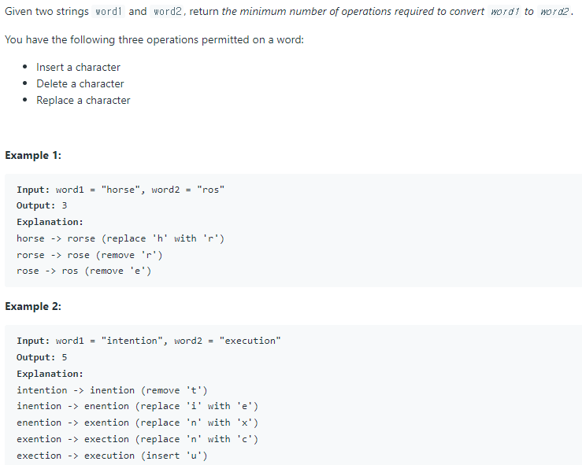

[https://leetcode.com/problems/edit-distance/](https://leetcode.com/problems/edit-distance/)

[Edit Distance - LeetCode](https://leetcode.com/problems/edit-distance/)



이 문제는 edit distance 알고리즘의 전형적인 예시이다.

한 문자열을 다른 문자열로 변환하는 데 필요한 최소 작업 수를 계산하는 문제이다.

예전에 푼 문제와 비슷한 듯하면서도 다른다.

[2021.12.02 - \[알고리즘\] - \[Python\] 리트코드 583. Delete Operation for Two Strings](https://bomoto.tistory.com/82)

[Python 리트코드 583. Delete Operation for Two Strings](https://bomoto.tistory.com/82)

1.

문자를 수정할 수 있는 방법은 insert, delete, replace 세 가지이다.

하지만 여기서 insert와 delete는 한 가지의 문자열을 기준으로만 생각했을 때 두 가지로 나뉘는 것일 뿐이다.

word1이랑 word2가 달라서 insert 혹은 delete를 해야 하는 순간에 항상 잉여 알파벳을 가진 문자열에서 delete를 해준다면 insert는 필요가 없어진다.

word1과 word2를 비교하고 두 문자를 같게 만들기 위해 delete만 해도 충분할지 replace를 해서 알파벳 두 개를 동시에 변경해줘야 하는지 확인할 것이다.

2.

알고리즘 풀이에 bottom-up방식을 이용할 것이라서 word1의 길이 X word2의 길이로 이중 배열을 만든다.

각 row와 col은 word1과 word2의 알파벳을 가리킨다.

문제의 첫 예시처럼 word1 = "horse", word2 = "ros" 일 때 row\[0\]의 col은 r, o, s를 나타내고 각 row의 col\[0\]은 h, o, r, s, e를 나타낸다.

만약 (1,2)를 가리키면 word2의 o와 word1의 r을 가리킨다.

하지만 이렇게만 하면 이전 결과가 없기 때문에 이전 결과를 바탕으로 현재 결과를 도출해내지 못한다.

그래서 가상의 이전 결과를 만들어줄 것인데, 공백을 이용하는 것이다.

word1을 word2와 비교할 때 word2의 첫 알파벳부터 비교하는 게 아니라 word2의 첫 알파벳조차 없던 때를 가정하고 dp를 작성하는 것이다.

어떤 알파벳이든 공백과 비교하면 결과는 무조건 '다르다'이다.

그렇기 때문에 두 개의 문자열을 상대 문자열의 비교 결과를 dp에 저장할 때 맨 첫 줄은 현재 문자열을 공백과 비교한 결과를 저장한다.

초기값은 \[\[0, 1, 2, 3\], \[1, 0, 0, 0\], \[2, 0, 0, 0\], \[3, 0, 0, 0\], \[4, 0, 0, 0\]\] 형태가 된다.

3.

이중 배열 dp의 값들은 해당 알파벳 기준으로 이전 문자열을 전부 확인했을 때 가장 적게 변형할 수 있는 횟수를 나타낸다.

그렇다면 이전 결과를 확인하기 위해서는 dp\[row-1\]\[col\], dp\[row-1\]\[col-1\], dp\[row\]\[col-1\] 이렇게 세 칸을 확인해야 한다.

만약 word1\[row\] 와 word2\[col\]의 알파벳이 일치하지 않는 경우 변형을 시켜야 하는데 이때 위의 세 경우를 확인하여 가장 적게 변형시키는 경우에 +1을 저장해주면 된다.

알파벳이 일치한다면 word1\[row-1\]과 word2\[col-1\]의 경우에 둘 다 같은 알파벳 하나씩을 추가시킨 것과 마찬가지이니 dp\[row-1\]\[col-1\]에 저장된 결과를 그대로 가져오면 된다.

```python
class Solution:
    def minDistance(self, word1: str, word2: str) -> int:
        m, n = len(word1), len(word2)
        dp = [list(range(n+1))]+[[i+1]+[0]*n for i in range(m)]

        for i in range(1, m+1):
            for j in range(1, n+1):
                if word1[i-1] == word2[j-1]:
                    dp[i][j] = dp[i-1][j-1]
                else:
                    dp[i][j] = min(dp[i][j-1], dp[i-1][j], dp[i-1][j-1]) + 1

        return dp[-1][-1]
```

참고: edit distance

[https://en.wikipedia.org/wiki/Edit\_distance](https://en.wikipedia.org/wiki/Edit_distance)

[Edit distance - Wikipedia](https://en.wikipedia.org/wiki/Edit_distance)
