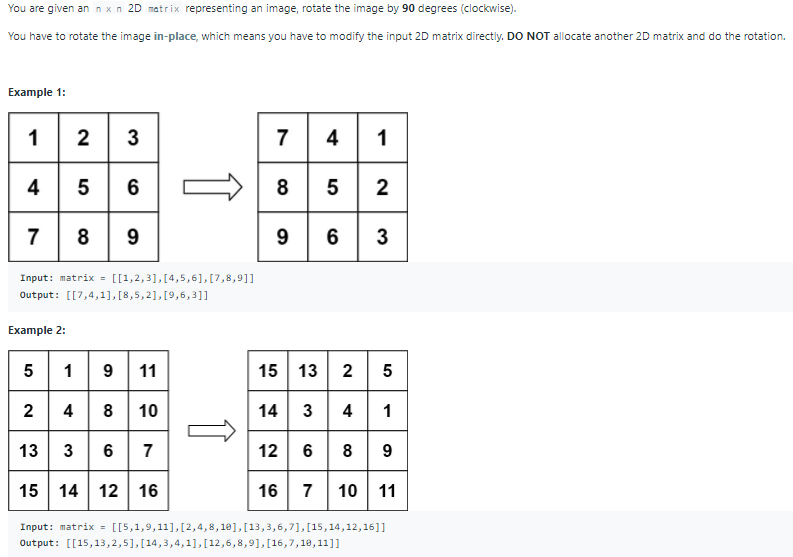

[https://leetcode.com/problems/rotate-image/submissions/](https://leetcode.com/problems/rotate-image/submissions/)

[Rotate Image - LeetCode](https://leetcode.com/problems/rotate-image/submissions/)



각 row를 거꾸로 정렬한 뒤 matrix를 왼쪽 위에서 오른쪽 아래 대각선으로 잘랐다고 생각하고 그 대각선을 기준으로 각 칸을 swap 해준다.

&amp;lt;Python>

```python
class Solution:
    def rotate(self, matrix: List[List[int]]) -> None:
        matrix.reverse()
        for i in range(len(matrix)):
            for j in range(i):
                matrix[i][j], matrix[j][i] = matrix[j][i], matrix[i][j]
```

&amp;lt;JavaScript>

```javascript
var rotate = function(matrix) {
    matrix.reverse();
    for(let i=0; i<matrix.length; i++){
        for(let j=0; j<=i; j++){
            let temp = matrix[i][j];
            matrix[i][j] = matrix[j][i];
            matrix[j][i] = temp;
        }
    }
};
```
