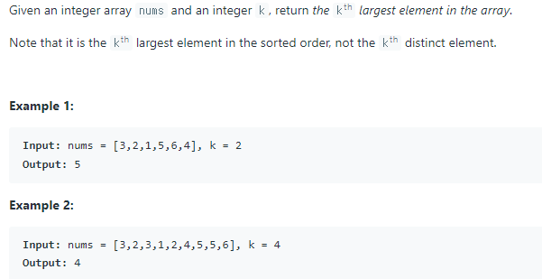

[https://leetcode.com/problems/kth-largest-element-in-an-array/](https://leetcode.com/problems/kth-largest-element-in-an-array/)

[Kth Largest Element in an Array - LeetCode](https://leetcode.com/problems/kth-largest-element-in-an-array/)



이 문제는 sort()를 사용하면 아주 간단히 풀 수 있지만 정렬 알고리즘 공부할 겸 quick sort 알고리즘을 구현하여서 풀었다.

quick sort는 pivot 값을 정한 뒤 그 값보다 작은 값과 큰 값을 구분해서 왼쪽 오른쪽에 배치한 뒤 두 파트를 재귀를 이용해 계속 정렬해나가는 알고리즘이다.

(왼편, pivot값, 오른편으로 나누기)

pivot을 결정해야 하는데 이 과정은 함수로 분리해서 pivot을 찾도록 한다.

pivot을 찾고 나면 그 과정을 통해 왼편에는 작은 값이, 오른편에는 큰 값이 위치할 것이다.

그러면 이제 왼편과 오른편을 또다시 재귀를 돌려준다.

(pivot 찾기)

\[0\]번을 pivot값으로 임의로 정한 뒤 i와 j를 이용해 범위를 좁혀나가면서 값을 증감한다.

i는 pivot보다 큰 값을 가리키도록 arr \[i\]가 pivot보다 작으면 계속 증가시키고 반대로 j는 arr \[j\]가 pivot보다 크면 감소시킨다.

그러면 결국 i는 pivot 보다 큰 값, j는 pivot 보다 작은 값을 가리키게 되는데 이때 둘을 swap 해준다.

이 과정을 i가 j보다 커지기 전까지 반복해주면 pivot값보다 작은 값은 왼편에, 큰 값은 오른편에 위치하게 된다.

마지막으로 pivot은 \[0\]의 값이었으니 j와 swap 해주면 pivot이 올바른 위치에 자리하게 된다.

```javascript
/**
 * @param {number[]} nums
 * @param {number} k
 * @return {number}
 */
var findKthLargest = function(nums, k) {
    const findPivot=(arr, l, r)=>{
        let i = l+1;
        let j = r;
        let pivot = arr[l];
        while(true){
            while(arr[i] >= pivot) i ++;
            while(pivot > arr[j] && i<=j) j --;
            // 여기에서 j는 pivot의 중간 지점의 바로 왼편에 위치해야한다.
            // 왜냐하면 j랑 pivot(인덱스0번)이랑 swap할거라서 pivot보다 작은 뭉탱이의 끝 지점을 가리켜야하기때문
            // (but 이문제에서는 reverse정렬해야해서 작은,큰 이 반대임)
            if(i<j){
                let temp = arr[i];
                arr[i] = arr[j];
                arr[j] = temp;
            }else{
                break;
            }
        }
        arr[l] = arr[j];
        arr[j] = pivot;
        return j;
    }

    const quickSort=(arr, l, r)=>{
        if(l < r){
            let pivot = findPivot(arr, l, r);
            quickSort(arr, l, pivot-1);
            quickSort(arr, pivot+1, r);
        }
        return arr;
    }

    return quickSort(nums, 0, nums.length-1)[k-1];
};
```
