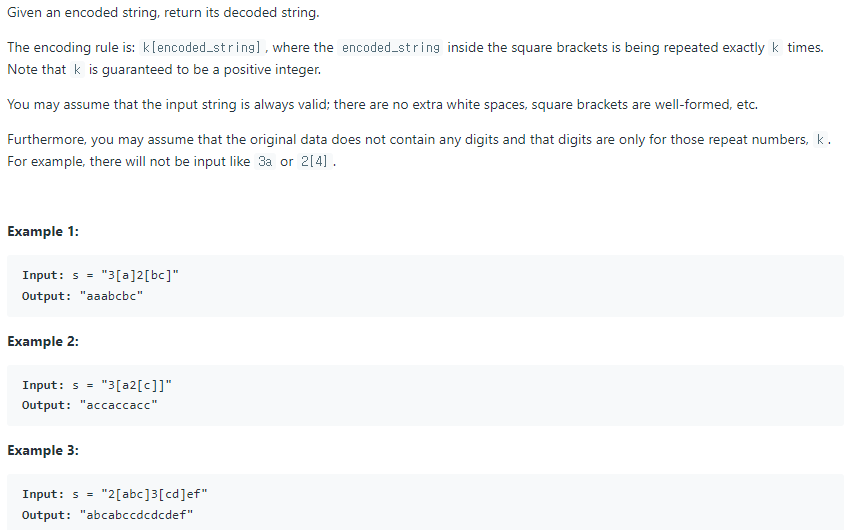

[https://leetcode.com/problems/decode-string/](https://leetcode.com/problems/decode-string/)

[Decode String - LeetCode](https://leetcode.com/problems/decode-string/)



스택 자료구조를 활용하기 적절한 문제이다.

숫자와 문자를 각각의 변수에 저장하고 있다가 여는 괄호를 만나면 스택에 담는다.

닫는 괄호를 만나면 저장해뒀던 숫자와 문자를 꺼낸다.

현재의 문자는 스택에서 꺼낸 숫자대로 반복해주고 스택에서 꺼낸 이전의 문자는 반복 없이 스트링 변수에 저장해준다.

주의해야 할 점은 숫자는 한자리 수 이상일 수 있기 때문에 이전의 숫자는 10을 곱해줘서 자릿수를 맞춰준다.

```python
class Solution:
    def decodeString(self, s: str) -> str:
        num = 0
        strs = ''
        numStack = []
        strStack = []
        for ss in s:
            # 여는 괄호 만나면 숫자와 문자를 스택에 각각 쌓고 초기화
            if ss == '[':
                numStack.append(num)
                strStack.append(strs)
                num = 0
                strs = ''
                continue
            if ss== ']':
                strs = strStack.pop() + (strs * numStack.pop())  # (이전에 모은 str)이랑 (현재괄호의 str)x반복  을 합침
                continue

            # 문자와 숫자 구분해서 누적
            if 97<=ord(ss)<=122:
                strs += ss
            else:
                num = (num)*10 + int(ss)

        return strs
```
