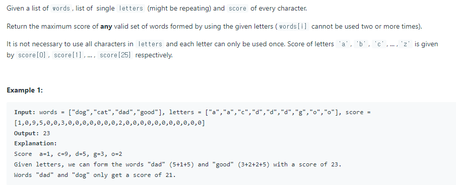

[https://leetcode.com/problems/maximum-score-words-formed-by-letters/](https://leetcode.com/problems/maximum-score-words-formed-by-letters/)

[Maximum Score Words Formed by Letters - LeetCode](https://leetcode.com/problems/maximum-score-words-formed-by-letters/)



collections.Count()를 사용해서 letters에 있는 알파벳들의 개수를 파악한다.

이를 count라고 할 때 words의 문자열을 확인할 때마다 count의 개수를 줄여나가야 한다.

words의 문자열을 취해서 점수를 계산할지 말지 선택할 때에 고려할 사항은 다음과 같다.

  - 현재 문자열이 점수를 계산할 수 있는 유효한 문자열인지

  - 현재 문자열을 선택하는게 다음 문자열을 선택하는 경우보다 이득인지

그렇기 때문에 dfs 알고리즘으로 풀어야 하는데 dfs함수에는 현재 검사하는 words의 인덱스와 count를 전달할 것이다.

1\. 이 함수에서는 letters를 count로 정리하는 작업처럼 words\[idx\]의 알파벳 별 개수를 구한다. ex) {d:1, o:1, g:1}

2\. 1에서 구한 알파벳 별 개수가 letters의 개수 이하여야 한다. (점수를 계산할 수 있는 유효한 문자열?)

3\. 2에서 실패했다면 현재 문자는 절대 안 된다. 따라서 다음 문자로 넘겨준다. (idx+1)

4\. 2에서 성공했다면 (words\[idx\]를 점수에 계산하는 것 / words\[idx+1\]을 점수에 계산하는 것) 둘 중 어느 게 이득인지 계산한다.

```python
class Solution:
    def maxScoreWords(self, words: List[str], letters: List[str], score: List[int]) -> int:
        def dfs(idx, counter):
            if idx == len(words): return 0

            wordCounter = collections.Counter(words[idx])  # 알파벳별 카운터

            totalScore = 0
            if all(counter[key] >= wordCounter[key] for key in wordCounter):
                wordScore = sum( score[ord(w)-97] for w in words[idx] )
                totalScore = max(   wordScore + dfs(idx+1, counter-wordCounter) , dfs(idx+1, counter)   )
            else:
                totalScore = dfs(idx+1, counter)

            return totalScore

        return dfs(0, collections.Counter(letters))
```
