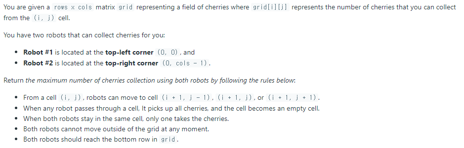
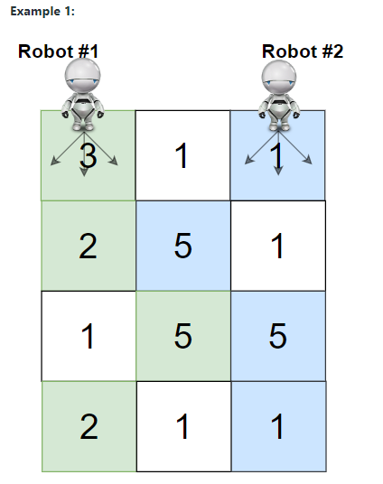
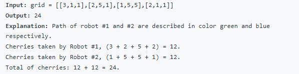

[https://leetcode.com/problems/cherry-pickup-ii/](https://leetcode.com/problems/cherry-pickup-ii/)

[Cherry Pickup II - LeetCode](https://leetcode.com/problems/cherry-pickup-ii/)







grid에서 경로를 선택하는 문제는 몇 번 풀었는데 이 문제는 경로를 선택하는 주체가 둘이다.

방법을 조금 고민하다 보면 두 로봇은 다음 row로 넘어갈 때 동시에 넘어가야 한다는 결론이 나온다.

bottom-up방식을 선택했는데 여기에는 로봇이 하나인 경우처럼 선택할 수 있는 루트의 합계를 누적하여 저장한다.

로봇이 하나일 때와 다른 점은 각 row를 가로로 col만큼 쪼갠 뒤 선택할 수 있는 두 가지 경우를 합한 값을 저장한다는 것이다.

좀 더 상세하게 적어보자면 grid가 4X3일 때 row를 column 수로 쪼개니까 12X3이 될 것이다.

이를 배열로 구현할 때는 row를 한 번에 쪼개는 것이 아닌 col을 쪼갠 것을 합치는 방식이기 때문에 dp는 삼중 배열이 된다.

즉 한 줄의 row는 3X3인 이중 배열이다.

이렇게 쪼개는 이유는 각 칸마다 로봇이 움직인 경우의 수를 모두 저장해주기 위해서이다.

1\. 현재 칸 최적의 선택

한 줄의 row만 살펴보자.

이중 배열의 x축과 y축에 각각 A, B, C로 이름을 붙인다 해보자

(A, A)에는 로봇 1이 이 전 칸에서 A로 가고 로봇 2가 이 전 칸에서 A로 간 경우

(A, B)에는 로봇 1은 A로 로봇 2는 B로 간 경우
(A, C)에는 로봇 1은 A로 로봇 2는 C로 가는 경우
(B, A)에는 로봇 1은 B로 로봇 2는 A로 가는 경우

....

를 저장한다.

2\. 이전 루트 중 최적의 선택

이렇게 하면 현재 위치에 있을 때의 최선을 결정을 할 수 있고 다음으로는 이 전 루트 중 최적의 루트를 구해서 방금 구한 결과와 더해주면 된다.

이 전 결과도 위와 같은 방법으로 저장된 결과가 있을 것이다.

그중에서 A칸을 계산하고 있다면 A칸과 인접한 이전 A, 이전 B 칸 중 선택하고 B칸을 계산하고 있다면 이전 A, 이전 B, 이전 C 중 선택한다.

3\. 두 로봇이 겹칠 경우

둘이 겹치는 곳으로는 가면 안 되니까 그냥 그 위치의 값을 0으로 저장한다.

어차피 다음 칸 계산 시 이전 결과의 MAX()로 루트를 결정하기 때문에 0으로 저장하면 해당 루트는 선택이 안된다.

\*\*

여기서 생각해야 할 점은 반복문을 돌릴 때 row는 거꾸로 돌려줘야 한다는 건데 그 이유는 로봇들의 시작 위치는 row\[0\]의 양 끝으로 고정되어 있다.

따라서 row를 순차적으로 돌릴 경우 마지막 줄에 최종 결과가 저장되는데 우리가 dp를 계산할 때는 로봇의 시작 위치는 고려하지 않았기 때문에 원하는 값을 얻지 못할 수도 있다.

그래서 row를 거꾸로 돌려주고 최종 결과로 로봇 1이나 로봇 2의 시작 위치를 리턴해줘야 한다.

로봇 1과 로봇 2의 시작 위치에는 어차피 같은 값이 저장되어 있으니 아무 곳이나 선택하면 된다.

```python
class Solution:
    def cherryPickup(self, grid: List[List[int]]) -> int:
        m = len(grid)
        n = len(grid[0])

        # grid를 가로로 col의 칸만큼 쪼개준 dp를 만듦
        dp = [[[0]*n for _ in range(n)] for __ in range(m)]

        # dp에 저장할 최고값 찾아주기
        def getValue(row, col1, col2):
            maxVal = 0
            for c1 in [-1, 0, 1]:
                for c2 in [-1, 0, 1]:
                    if 0<=col1+c1<n and 0<=col2+c2<n:
                        maxVal = max(maxVal, dp[row+1][col1+c1][col2+c2])
            return maxVal

        # row를 거꾸로 돌려야함
        for row in range(m-1, -1, -1):
            for col1 in range(n):
                for col2 in range(n):
                    total = 0
                    if col1 != col2:
                        total += grid[row][col1] + grid[row][col2]

                        # 마지막 row는 아랫줄이 없으니 패스
                        if row < m-1:
                            total += getValue(row, col1, col2)

                    dp[row][col1][col2] = total

        return dp[0][0][-1]  # 로봇1위치 리턴
```
