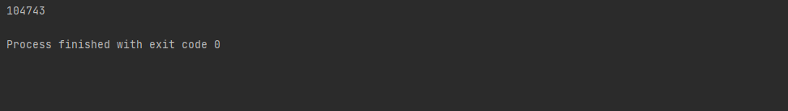

[https://projecteuler.net/problem=7](https://projecteuler.net/archives)

[Archived Problems - Project Euler](https://projecteuler.net/archives)

7번 문제)

> By listing the first six prime numbers: 2, 3, 5, 7, 11, and 13, we can see that the 6th prime is 13.
> What is the 10 001 st prime number?

6번째 소수가 13이라면 10001번째 소수는 무엇인가?

편하게 읽기 위해 함수를 두 개로 쪼개서 만들었다.

하나는 소수를 판별할 함수, 하나는 10001까지 반복문을 돌릴 함수이다.

```python
def isPrimeNumber(n):
    i = 1
    while i < n:
        i = i+1
        if n % i != 0:
            continue
        else:
            return True if n == i else False

def loop(n):
    cnt = 0
    j = 1
    while cnt < n:
        if isPrimeNumber(j):
            cnt = cnt + 1
        if cnt == n:
            return j
        j = j+1

answer = loop(10001)
print(answer)
```

isPrimeNumber에서 입력받은 n을 소수 판별해서 True/False로 되돌려주고

loop에서는 cnt가 입력받은 n(10001)이 될 때까지 반복문을 실행한다.

마지막 10001번째 숫자만 변수 answer에 담아 출력한다.

그 결과!



아래는 10001개의 소수들 리스트도 출력하는 코드이다.

역시 잘 실행된다.

```python
list = []

def isPrimeNumber(n):
    i = 1
    while i < n:
        i = i+1
        if n % i != 0:
            continue
        else:
            return True if n == i else False

def loop(n):
    j = 1
    while len(list) < n:
        if isPrimeNumber(j):
            list.append(j)
        if len(list) == n:
            return j
        j = j+1

answer = loop(10001)
print('answer:', answer)
print(list)
```
