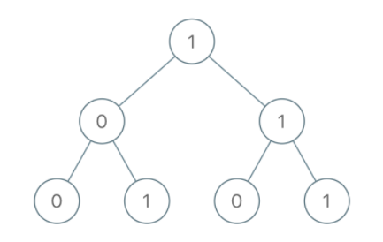

[https://eetcode.com/problems/sum-of-root-to-leaf-binary-numbers/](https://leetcode.com/problems/sum-of-root-to-leaf-binary-numbers/)

[Sum of Root To Leaf Binary Numbers - LeetCode](https://leetcode.com/problems/sum-of-root-to-leaf-binary-numbers/)

\==문제==

트리 노드에서 각 leaf는 이진법으로 표현된 숫자이다.

이때 모든 leaf의 숫자를 10진법으로 변환 한 뒤 더하라.



예를 들어 위 트리 같은 경우는 100+101+110+111을 10진법으로 표현해 4+5+6+7이고 정답은 22이다.

\==접근방법==

이진법으로 나타낸 숫자이니까 값이 전부 1이라고 한다면 제일 아래 노드는 2^0이고 그 윗 노드는 2¹, 그 위는 2²이다.

노드가 딱 한 개만 있는 경우는 최상단 노드가 최하단 노드와 마찬가지이므로 2^0이다.

그 노드에 자식 노드가 한 개 추가되었다면 최상단 노드는 2¹로 바뀌고 자식의 자식 노드가 추가되었다면 최상단 노드는 2²이 된다.

그렇다면 자식 노드의 개수가 하나씩 추가될 때마다 모든 노드의 제곱수가 1씩 증가된다는 뜻이다.

제곱수가 증가한다는 건 현재까지의 값에 x2가 된다는 뜻이므로 노드를 아래로 탐색하면서 현재까지 구한 값에 x2를 해주면 된다.

새로운 자식 노드를 만났을 때 (바로 위 노드까지의 값)+(새로 만난 노드)를 해주면 새 자식 노드로 인해 생기는 값을 구할 수 있다.

이 값은 '새로 생기는 값'이라서 추가로 바로 위 노드까지 구했던 값을 더해줘야 전체 값을 구할 수 있다.

(새로 만난 노드)의 값은 그 노드의 데이터가 1이라면 십진수로 나타낼 경우 2^0일 것이고 0이면 십진수로도 0 그대로인데 2^0은 1이니까 그 노드의 값 그대로를 더해주면 된다.

최상단 노드 값을 A, 그다음 노드 값을 B, 제일 하단 노드 값을 C라고 가정해보자.

깊이 1인 트리일 때 십진수 값은 A이다.

깊이 2인 트리일 때는 깊이 1이었을 때의 값 A에 깊이가 2로 증가하면서 얻게 된 A, B가 더해져 십진수 값은 AAB이다.

깊이 3인 트리일 때는 깊이 2였을 때의 값 AAB에 깊이가 3으로 증가하면서 얻게 된 A, A, B, C가 더해져 AAAABBC이다.

이 로직대로 dp알고리즘을 사용해서 풀었다.

참고로 이 문제는 전에 풀었던 알고리즘과 비슷하다.

[2021.06.18 - \[알고리즘\] - \[Python\] 리트코드 1402 : Reducing Dishes (DP)](https://bomoto.tistory.com/29)

\==코드==

```python
class Solution:
    def sumRootToLeaf(self, root: TreeNode) -> int:
        def getSum(root:TreeNode, prev) -> int:
            leftRightSum = 0  # 왼,오 값의 합계를 한꺼번에 윗 노드에 리턴할꺼임
            if not root.left and not root.right:
                return prev + root.val  # 젤 아래 노드 값 = 앞에값 + 현재값
            # 왼,오가 둘다 null이 아니라면
            if root.left:
                leftRightSum += getSum(root.left, (prev+root.val)*2)
            if root.right:
                leftRightSum += getSum(root.right, (prev+root.val)*2)
            return leftRightSum
        return getSum(root, 0)
```
