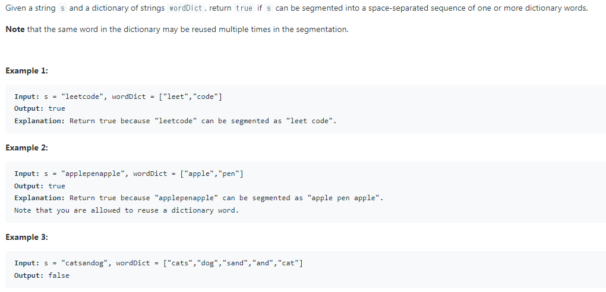

[https://leetcode.com/problems/word-break/](https://leetcode.com/problems/word-break/)

[Word Break - LeetCode](https://leetcode.com/problems/word-break/)



```python
class Solution:
    def wordBreak(self, s: str, wordDict: List[str]) -> bool:
        @lru_cache(None)  # 결과 캐싱
        def isInDict(start):
            # 4. 3번에서 재귀돌렸을때 현재문자열위치+1을 보내니까
            # 그걸 시작위치로 받았을 때 그게 전체 문자열길이와 같다면 끝까지 돌때까지 False로 안떨어진것
            if start == len(s): return True

            # 2. 받은 시작위치부터 문자열의 끝까지 검사함
            for end in range(start, len(s)):
                word = s[start:end+1]
                # 3. 문자열이 사전에 있다면
                if word in wordDict:
                    res = isInDict(end + 1)
                    # 3-1. 그 이후의 문자열도 검사해서 다 있는 단어라면 True
                    if res: return True
                    # 3-2. 그 이후의 문자열중 사전에 없는애가 있다면 False
                    else: continue

            return False

        return isInDict(0)  # 1. 시작 위치를 넘김
```

주어지는 s가 leetcode라면

l

le

lee

leet

leetc

...

과 같은 방식으로 지정한 시작 위치부터 한 알파벳씩 늘려가며 wordDict에 있는지 체크한다.

만약 wordDict에 있는 단어 묶음을 발견했다면 그 묶음의 끝위치 바로 다음 인덱스를 인자로 재귀 함수를 호출하여 뒤의 문자열을 검사한다.

재귀 함수에서 start가 len(s)와 같아졌다면 그 뒤의 문자열도 다 wordDict에 있다는 의미이다.

왜냐하면 결국 마지막 word가 wordDict에 없는채로 끝난다면 해당 조건문으로 가지 않고 재귀 함수의 return False문으로 바로 이동할것이기 때문이다.

그러므로 start가 len(s)와 같다는건 마지막으로 검사할 word가 wordDict에 있었다는 뜻이다.
