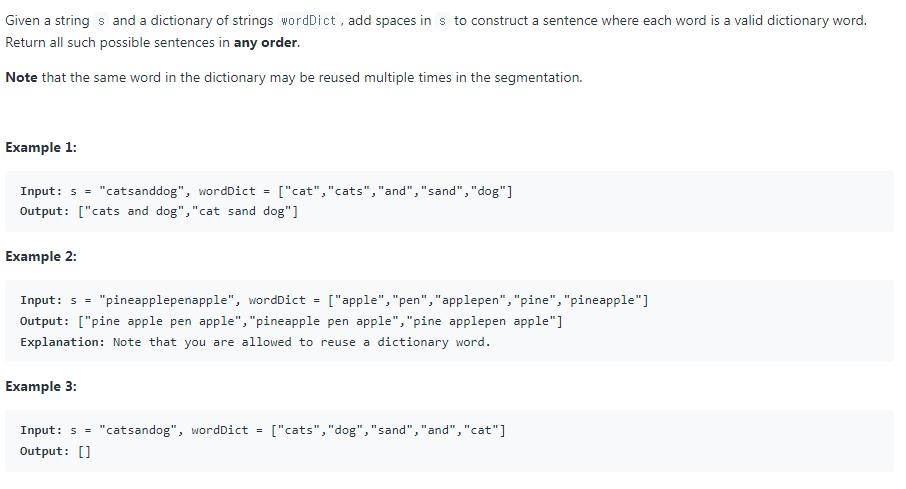

[https://leetcode.com/problems/word-break-ii/](https://leetcode.com/problems/word-break-ii/)

[Word Break II - LeetCode](https://leetcode.com/problems/word-break-ii/)



```python
class Solution:
    def wordBreak(self, s: str, wordDict: List[str]) -> List[str]:
        def isInDict(start, words):
            # 4. 3에서 end+1하기 땜에 시작위치가 len(s)라면 정상적으로 찾은거
            if start == len(s):
                answer.append(' '.join(words))
            # 2. 넘겨받은 시작위치 ~ 끝위치 하나씩 알파벳 추가해서 검사
            for end in range(start, len(s)):
                word = s[start:end+1]
                # 3-1. 사전에 있으면 (시작위치는+1, 찾은 목록에 추가)해서 다음 재귀로 넘김
                if word in wordDict:
                    res = isInDict(end+1, words+[word])
                    # print(word, res)
                # 3-2. 없으면 다음꺼 계속
                else: continue
            return []

        answer = []
        # 1. 재귀 함수로 (시작위치, 사전에 있는 목록) 넘김
        isInDict(0, [])

        return answer
```

바로 이전 알고리즘 문제인 word Break와 아주 비슷한 문제이다.

다른 점은 첫번재 문제는 문자열 s를 wordDict에서 찾을 수 있는지 아닌지의 여부를 묻는 것이었고 이 문제는 문자열 s가 wordDict에 있으면 그 단어들을 문자열로 만들어서 가능한 문자열을 모두 리스트로 리턴하는 것이다.

그래서 True인지 False인지를 리턴하는 대신 정답 목록에 문자열로 변환한 단어 리스트를 계속 추가해주면 된다.
