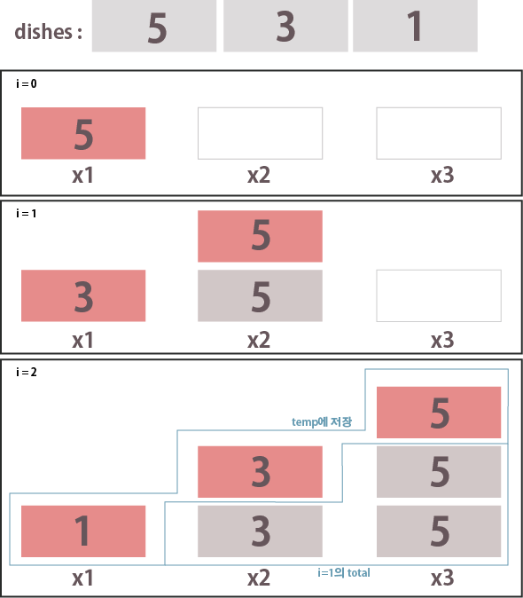

[https://leetcode.com/problems/reducing-dishes/](https://leetcode.com/problems/reducing-dishes/)

[Reducing Dishes - LeetCode](https://leetcode.com/problems/reducing-dishes/)

\==문제==

셰프가 가지고 있는 접시 별로 손님들이 느끼는 만족도가 저장된 리스트 satisfaction이 있다.

이 접시들 중 어떤 걸 사용할지 정할 건데 접시가 배치된 순서에 따라 총만족도가 결정된다.

뒤에 위치한 접시일수록 높은 계수를 부여받아 높은 만족도를 달성할 수 있다.

예를 들어 만족도가 \[5,3,7\]인 접시들이 있을 때 이 접시를 \[3,5,7\] 순서로 배치하면 최종 만족도는 (3\*1)+(5\*2)+(7\*3)이 된다.

만족도가 마이너스일 경우도 있어서 최종 만족도를 떨어뜨리게 된다면 어떤 접시는 사용하지 않을 수도 있다.

가장 높은 최종 만족도를 구하면 된다.

\==접근방법==

satisfaction을 내림차순으로 정렬해서 satisfaction\[0~len\]의 접시를 차례로 계수 1 위치에 추가시킨다.

그때의 총 만족도들을 리스트에 저장해서 가장 높은 만족도를 리턴할 것이다.

satisfaction이 \[5,3,1\]이라면

1.  0번째 위치인 5를 사용할 경우의 만족도를 구한다.
    접시가 한 개이기 때문에 계수는 1이어서 만족도는 (5\*1)이다.
2.  다음으로 큰 수인 3이 0번째 위치에 추가된다면 5는 한 칸 뒤로 밀려나게 되어 5의 계수는 2가 된다.
    이때의 만족도는 (3\*1)+(5\*2)이다.
    이것을 잘 보면 처음 경우의 만족도였던 (5\*1)에 (3\*1)+(5\*1)이 더해졌단 걸 알 수 있다.
3.  똑같은 방법으로 1이 0번째 위치에 추가되면 만족도는 (1\*1)+(3\*2)+(5\*3)이 된다.
    역시 두 번째의 만족도였던 (3\*1)+(5\*2)에 (1\*1)+(3\*1)+(5\*1)이 추가된 것과 같다.

tempTotal에 새로 더해지는 값인 (이번에 새로 추가된 값)+(한 칸씩 밀려난 값)을 저장한다.

위의 로직을 보면 한 칸씩 밀려나는 값은 사용될 접시들을 전부 더한 것과 같다. (계수가 모두 1이니까)

총만족도인 total을 구하려면 이 전 루프에서 계산된 만족도가 저장된 상태의 total에 tempTotal을 더해주면 된다.

그림으로 정리하면 이렇다.



\==최종 코드==

```python
class Solution:
    def maxSatisfaction(self, satisfaction: List[int]) -> int:
        result = []  #합계 결과들 저장
        total = 0  #전체 총 합
        tempTotal = 0  #한 칸 밀릴 숫자들 합
        satisfaction.sort(reverse=True)
        if satisfaction[0] < 0:
            return 0
        for num in satisfaction:
            tempTotal = tempTotal + num
            if total == 0:
                total = num
            else:
                total = total + tempTotal
                result.append(total)
        return max(result)
```
