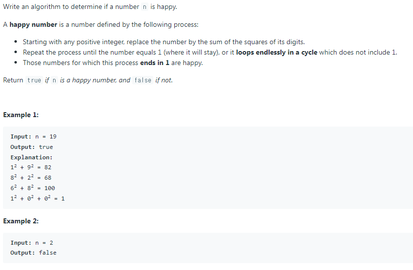

[https://leetcode.com/problems/happy-number/](https://leetcode.com/problems/happy-number/)

[Happy Number - LeetCode](https://leetcode.com/problems/happy-number/)



문제는 간단하다.

숫자를 각 자리수별로 쪼개서 제곱한다음 모두 더해 1을 만들 수 있다면 True를 반환하면 된다.

아주 간단해보이지만 문제는 4 -> 16 -> 37 -> 58 -> 89 -> 145 -> 42 -> 20 -> 4 -> ... 처럼 계속 루프에 갇혀 빠져나가지 못하는 경우가 있다는 것이다.

이 문제는 two pointer를 이용해서 풀면 쉽게 풀 수 있는데

[https://leetcode.com/problems/linked-list-cycle/](https://leetcode.com/problems/linked-list-cycle/)

[Linked List Cycle - LeetCode](https://leetcode.com/problems/linked-list-cycle/)

이 문제와 아주 유사하다.

\==코드==

```python
class Solution:
    def isHappy(self, n: int) -> bool:
        def getNextNum(n):
            sum = 0
            while n:
                sum += (n%10) * (n%10) # 일의자리부터 일단 제곱 계산
                n //= 10  # 십의자리를 일의자리로 밀어서 또 계산
            return sum

        slow, fast = n, getNextNum(n)
        while slow != fast:
            slow = getNextNum(slow)
            fast = getNextNum(getNextNum(fast))

        return slow == 1
```

slow와 fast 포인터 두 개를 만들고 fast는 slow의 두배만큼 빠르게 탐색을 한다.

1\. 루프가 없을 경우

n이 결국에 1값을 가지게 된다면(결과가 True)라면 fast가 먼저 1을 가지고 있을 것이고 slow가 뒤따라 1을 가지게 될 것이다.

2\. 루프가 있을 경우

루프 안에서 fast는 두 걸음을 가고 slow는 한걸음을 가기 때문에 두 포인터는 언젠가는 만나게 된다.

그때 값이 1이 아니라면 결국에 n은 영원히 1에 도달하지 못하는 것이니 False를 리턴한다.

그리고 다음에 문제를 풀때 getNextNum함수 로직을 참고하면 좋을것같다.

각 자리수를 제곱하여 합계를 구하기 위해 쓰이는데 먼저 일의 자리의 제곱-합계를 구하고 그다음에 십의자리를 일의 자리로 땡겨와서 일의 자리가 된 십의 자리를 또 제곱-합계를 구한다.

예를들어 81의 다음 숫자를 구해야 한다고 했을 때 (1 \* 1) + (8 \* 8) 의 과정을 해주는것이다.

81을 10으로 나눈 나머지로 계산흘 해주고 그 몫은 다음 n으로 설정한다.

sum은 (1\*1) = 1이, n은 8이 된다.

거기서 또 똑같은 계산을 해주어 sum + (8\*8)을 해주면 된다.
