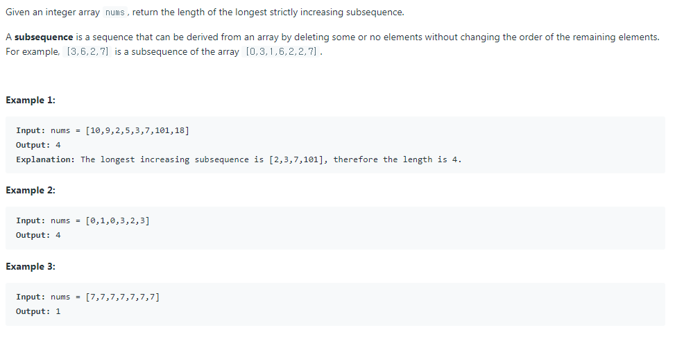

[https://leetcode.com/problems/longest-increasing-subsequence/](https://leetcode.com/problems/longest-increasing-subsequence/)

[Longest Increasing Subsequence - LeetCode](https://leetcode.com/problems/longest-increasing-subsequence/)



**My Code**

```python
class Solution:
    def lengthOfLIS(self, nums: List[int]) -> int:
        dp = [1] * (len(nums))
        for i in range(len(nums)):
            for j in range(i):
                if nums[i] > nums[j]:
                    dp[i] = max(dp[j] + 1, dp[i])
        return max(dp)
```

**Explanation**

nums의 길이와 같은 리스트 dp를 만들어서 여기에 i번째까지만 봤을 때의 가장 긴 subsequence를 기록할것이다.

문제의 첫번째 예시처럼 nums = \[10, 9, 2, 5, 3, 7, 101, 18\]일때 dp는 \[1, 1, 1, 2, 2, 3, 4, 4\]가 나와야 한다.

그렇다면 이중 for문을 사용해서 i는 subsequence의 끝위치(앞에 몇개의 Subsequence가 있는지 저장해야할 곳), j는 시작 위치로 지정하여 검사를 할 것이다.

끝위치를 한칸씩 늘려가며 그 앞의 요소들을 확인했을 때 nums의 i번째보다는 앞의 요소가 작아야 '증가'한다는 조건을 만족한다.

그러니 일단 nums\[i\]와 nums\[j\]를 비교해주고 기록용 리스트인 dp에는 증가하는 Subsequence의 최고 개수를 저장해야 하니까 max함수를 써서 값을 기록해준다.

max에서 비교할 값은 두가지인데 하나는 현재 dp\[i\]에 저장된 값이 더 크면 바꾸면 손해이므로 이 값이고 두번째는 j번째(i보다 앞에있면서 i보다 더 작은 값)에 \[i\]까지를 포함한 값인 dp\[j\]+1이다.

이렇게 for문을 전부 돌고나면 dp에 각 위치별 Longest Increasing Subsequence의 개수가 저장된다.

마지막으로 dp의 max값을 뽑으면 원하는 답이 나온다.
