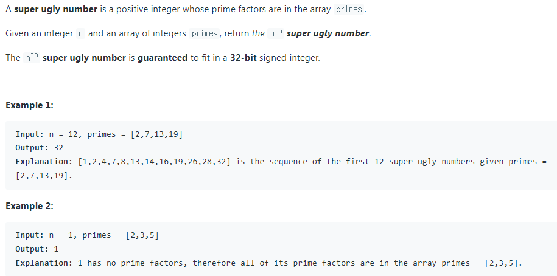

[https://leetcode.com/problems/super-ugly-number/](https://leetcode.com/problems/super-ugly-number/)

[Super Ugly Number - LeetCode](https://leetcode.com/problems/super-ugly-number/)



이 문제는 예전에 풀었던 264. Ugly Number II ([https://leetcode.com/problems/ugly-number-ii/](https://leetcode.com/problems/ugly-number-ii/)) 이 문제와 비슷하다.

그래서 그 문제를 응용해서 풀어보았다.

결국 primes factors를 구하는 문제인건데 주어지는 primes에 있는 숫자들로 만들 수 있는 목록을 구하려면 작은 수부터 차례로 계산해나가면 된다.

n번째 ugly number를 구하는 문제이니 ugly number를 저장할 리스트를 만들고 그 리스트와 primes의 숫자들을 차례로 곱해나간다.

첫 번째 예시로 살펴보자면, 제일 처음에는 1은 고정으로 들어가니까 \[1\]로 ugly number 배열을 초기화해준다.

그다음 primes의 숫자들을 ugly number의 배열에 있는 숫자들과 계산해주어야 하는데 지금은 ugly number에 1밖에 없으니 각각 곱해본다.

그러면 각각 2, 7, 13, 19라는 결과가 나온다.

이 중에서 가장 작은 값인 2를 ugly number에 추가해준다.

그럼 이다음에 와야 할 숫자는 무엇일까?

primes로 만들 수 있는 숫자 중에 2보다는 크면서 가장 작은 숫자가 다음에 추가될 숫자인데 이 숫자는 4라는 걸 우리는 알고 있다.

이 4는 우리가 ugly number에 추가할 숫자로 2를 얻었던 것처럼 primes의 2를 ugly number의 \[1\] 번째인 2와 곱한 숫자이다.

그럼 ugly number에 4를 추가해주고 또 다음 숫자를 구해보면 그다음은 7이다.

이 7은 primes의 7에 ugly number의 \[0\]인 1을 곱한 결과이다.

이런 방식으로 다음엔 8, 13, 14, ... 가 추가된다.

여기서 primes의 숫자들이 각각 현재까지의 ugly number와 차례로 곱해 나가는 결과가 ugly number라는 것을 알 수 있다.

primes의 숫자들마다 ugly number와 곱해줄 숫자의 인덱스가 다르기 때문에 이것을 각각 관리해주어야 한다.

```python
class Solution:
    def nthSuperUglyNumber(self, n: int, primes: List[int]) -> int:
        uglys = [1]  # 결과들을 저장할곳
        idxs = [0] * len(primes)  # primes랑 곱한 각각의 마지막 uglys 위치가 어디?
        lastVals = primes[:]  # 곱셈 마지막 결과 저장한곳. 첨엔 1이랑 곱한상태니까 걍 primes그대로임

        i = 0
        while i < n-1:
            # 1. 최소값 추가해주기
            minNum = min(lastVals)
            uglys.append(minNum)

            # 2. 값들을 갱신해줌
            for j in range(len(primes)):
                if lastVals[j] == minNum:
                    idxs[j] += 1  # 그 prime이 uglys에서 마지막으로 곱한 수의 위치를 1증가
                    lastVals[j] = primes[j] * uglys[idxs[j]]  # 마지막 계산 결과에 (그 prime * uglys의 새로 곱해줘야하는 애)
                # **index로 찾아서 하니까 timeout나서 방법 바꿔봄
            i += 1

        return uglys[-1]
```

primes의 길이와 같은 리스트를 만들어서(idxs) 여기서 primes의 각 요소들이 ugly number의 몇 번째 숫자까지 계산했었는지 저장한다.

lastVals 리스트에는 primes랑 ugly number의 곱셈 마지막 결과를 각 primes별로 저장해놓을 것이다.

이는 다음에 ugly number에 추가할 값인 각 primes의 곱셈 값 중 최솟값을 편하게 구하기 위한 리스트이다.

이 리스트를 저장해 두지 않으면 매번 primes와 ugly number를 곱한 결과를 얻어야 하기 때문이다.

이제 while문으로 들어가서 다음에 추가할 수 있는 숫자 중 가장 작은 값을 ugly number에 추가해준다.

추가하고 난 값은 다음번 값으로 바꿔줘야 하니까 방금 추가한 최솟값이랑 lastVals의 값이 같다면 그 값을 경신해준다.

\*여기서 최솟값을 lastVals에서 찾을 때 index()를 썼었는데(중복 값은 따로 처리했음) TimeLimit에러가 떴다. 때문에 index()를 버리고 for문으로 전부 확인하는 것으로 바꾸었다.

해당 primes의 숫자가 ugly number에서 곱했던 인덱스를 하나 증가시키고 마지막 계산 결과인 lastVals에 해당하는 값도 (해당 primes의 숫자 X ugly number\[i\])로 갱신해준다.
