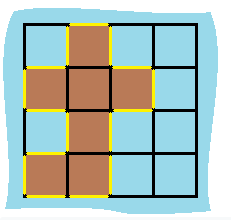

[https://leetcode.com/problems/island-perimeter/](https://leetcode.com/problems/island-perimeter/)

[Island Perimeter - LeetCode](https://leetcode.com/problems/island-perimeter/)



grid = \[\[0,1,0,0\], \[1,1,1,0\], \[0,1,0,0\], \[1,1,0,0\]\]

그림처럼 1은 땅을 0은 물을 뜻한다.
이때 땅의 둘레를 구하는 문제

\==풀이==

1\. 땅 두 칸이 붙어 있으면 겹치는 선이 한 개일 것이다.

2\. 겹치는 것 생각하지 않고 각 네모의 둘레를 모두 구했을 때는 4면 X 2개 = 8이다.

3\. 합쳐진 두 개의 칸의 둘레는 6 (최종 답)

위에서 \[각 땅의 둘레 - 겹치는 선의 개수 X2\]를 하면 답이 나온다는 걸 알 수 있다.

각 땅의 둘레 = (땅의 개수 X4)이니까 결국에 알아야 하는 건 두 가지이다.

①땅의 개수 ②겹치는 선의 개수

grid 이중 반복문을 확인해서 값이 1이면 땅의 개수에 +1을 해준다.

그럼 이제 겹치는지를 확인해야 한다.

모든 칸이 자신의 위칸과 왼쪽 칸을 확인하면 겹치는 선을 전부 확인할 수 있다.

하지만 제일 윗 행인 i=0일 때와 제일 왼쪽 열인 j=0일 때는 각각 내 위칸과 내 왼쪽 칸이 없기 때문에 이 경우는 나머지 칸들과 다르게 계산해준다.

 - 제일 윗 행과 제일 왼쪽 열:  각각 \[j-1\]과 \[i-1\]에 1이 있는지(겹치는지)를 확인한다.

 - 나머지 칸: 겹치는 선이 있는지 위칸과 왼쪽 칸을 둘 다 검사한다.

마지막에는 처음에 구했던 공식인 (땅의 개수 X4) - (겹치는 선의 개수 X2)로 답을 도출하면 된다.

\==코드==

```python
class Solution:
    def islandPerimeter(self, grid: List[List[int]]) -> int:
        square = 0  # 네모의 갯수
        commonLine = 0  # 겹치는 라인 수 (겹치는 라인이 있으면 네모 하나씩 두번을 빼줘야함)
        for i in range(len(grid)):
            for j in range(len(grid[0])):
                if grid[i][j] == 1:
                    square += 1
                    # 젤 위 / 젤 왼쪽 / 나머지 따로 계산
                    if i == 0 and j > 0 and grid[0][j-1] == 1:
                        commonLine += 1
                    elif j == 0 and i > 0 and grid[i-1][0] == 1:
                        commonLine += 1
                    elif i != 0 and j != 0:
                        if grid[i-1][j] == 1: commonLine += 1
                        if grid[i][j-1] == 1: commonLine += 1
        return (square*4) - (commonLine*2)
```
