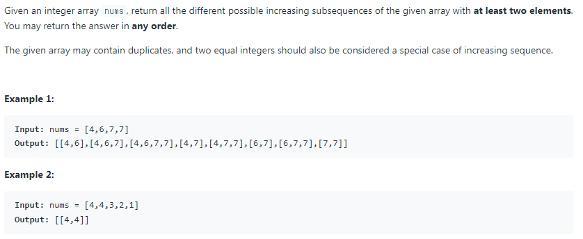

[https://leetcode.com/problems/increasing-subsequences/](https://leetcode.com/problems/increasing-subsequences/)

[Increasing Subsequences - LeetCode](https://leetcode.com/problems/increasing-subsequences/)



이 문제는 예전에 풀었던 문제와 방식이 비슷했다.

[https://leetcode.com/problems/letter-tile-possibilities/](https://leetcode.com/problems/letter-tile-possibilities/)

[Letter Tile Possibilities - LeetCode](https://leetcode.com/problems/letter-tile-possibilities/)

이 문제인데 주어진 문자열의 모든 조합 경우의 수를 구하는 문제였다.

순서를 바꾸는것도 고려해야 하고 중복은 당연히 없어야 한다.

지금 푸는 문제와는 순서가 바뀌는 경우는 없다는점만 다르다.

그래서 로직을 그대로 가져왔다.

먼저 선택한 목록과 선택하지 않은 목록 두가지로 분리해서 내부 함수에 전달한다.

가장 처음에는 nums에서 각 한개씩만 선택된 상태일테니 해당 요소(선택한), 그리고 그 뒤의 요소들(선택하지 않은)을 전달한다.

인수를 전달받은 내부 함수에서는 선택하지 않은 목록을 확인해서 이미 선택한 목록의 제일 마지막 숫자보다 같거나 큰 수가 나온다면(이미 오름차순일테니 마지막만 확인) 선택한목록에 그 숫자를 포함시켜서 정답에 추가한다.

그리고 방금 정답에 추가한 데이터대로 다시 선택목록, 남은목록을 함수로 다시 전달한다.

남은 목록이 하나도 없거나 이미 체크한 숫자라면 이 과정을 생략한다.

```python
class Solution:
    def findSubsequences(self, nums: List[int]) -> List[List[int]]:
        answer = []
        size = len(nums)
        def func(selected, nums):
            used = []  # 중복 방지
            if len(nums) == 0:
                return
            for i,n in enumerate(nums):
                if selected[-1] <= n and n not in used:
                    used.append(n)
                    if selected+[n] not in answer:
                        answer.append(selected+[n])  # 정답에 추가
                        func(selected+[n], nums[i+1:])  # 선택한 목록에 추가하여 또 반복
            return

        for i in range(size-1):  # 마지막은 최소 2개가 될 수 없으니 제외
            func([nums[i]], nums[i+1:])
        return answer
```
