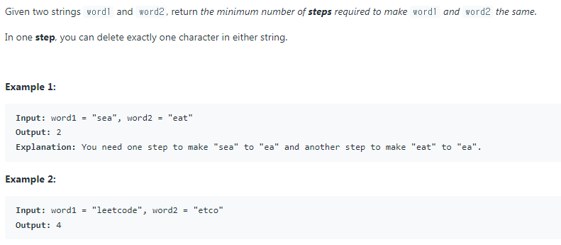

[https://leetcode.com/problems/delete-operation-for-two-strings/](https://leetcode.com/problems/delete-operation-for-two-strings/)

[Delete Operation for Two Strings - LeetCode](https://leetcode.com/problems/delete-operation-for-two-strings/)



먼저 word1이랑 word2에서 공통된 알파벳들을 알아낸다.

공통되지 않은 알파벳들은 조작되어야 하는 알파벳이므로 word1과 word2의 각 length를 비교해 그 차이만큼 답으로 리턴한다.

공통된 알파벳을 가려내는데 고려해야 하는 사항 두 가지가 있는데 하나는 알파벳이 서로 떨어져 있더라도 순서는 동일해야 한다는 것이고 다른 하나는 중복되는 알파벳 처리를 해줘야 한다는 것이다.

word1에서 각 알파벳을 확인해서 그 알파벳이 word2에 있는지, 있다면 몇 번째 위치에 있는지 알아낸다.

공통되는 알파벳 중 가장 긴 길이의 값이 저장될 common리스트를 만들고 0으로 초기화한다.

 -> 알파벳이 word2에 없다면 별다른 처리 없이 다음 알파벳으로 넘어가면 된다.

 -> 알파벳이 word2에 있다면 그 위치보다 common의 앞 인덱스 중 가장 큰 값에 +1을 해준다.

만약 word1 = "zab", word2 = "abz" 라면 word1과 word2에서 공통되는 건 "ab"이다.

word1의 z가 word2에서는 \[2\]에 있으므로 common에서 \[0:1\]을 살펴본다.

가장 큰 값에 + 1 을해서 common\[2\]에 저장한다. common = \[0, 0, 1\]

그다음 word1의 a는 word2\[0\]에 있다.

위의 과정을 동일하게 반복한 결과 common = \[1, 0, 1\]이 된다.

마지막으로 word1의 b는 word2\[1\]에 있다.

이 인덱스 1보다 전 값을 common에서 찾으면 common \[0\]에 1 값이 저장되어 있으니 여기에 +1을 한 2가 common\[1\]에 들어간다. common = \[1, 2, 1\]

그래서 word1과 word2의 연속되지 않더라도 가장 길게 겹치는 단어의 길이는 max(common) = 2가 된다.

이 값을 word1의 길이와 비교하면 1만큼의 조작이 필요하다는 결과가 나오고 word2의 길이와 비교한 것도 1만큼의 조작이 필요하다.

이 조작이 필요한 값을 더하면 최종 답이 나온다.

하지만 문제가 발생했는데 위에서 말한 두 번째인 고려해야 할 사항인 중복을 처리하는 부분이다.

예를 들어
word1 = 'intention'
word2 = 'execution'  # answer : 8

위와 같은 입력은 word2에 'e'가 두 번 들어가 있어서 word2에서 'e'를 찾을 때 두 번째 'e'는 확인하지 못하게 된다.

word1 = "algorithm"
word2 = "altruistic"  # answer : 9   공통: alrit

이 입력에서도 같은 문제를 가지고 있다.

word2에 't'가 두 번 나와서 두 번째 't'를 선택한 상황을 체크하지 못하는데 운 나쁘게도 뒤에 't'를 선택해야 정답이 된다.

그래서 word1와 word2를 이중 for문으로 하나하나씩 비교하도록 수정했다.

word1와 word2의 알파벳을 전부 매치해서 검사해 두 알파벳이 같다면 그때 common에서 이전 인덱스에 저장된 값을 찾도록 했다.

그리고 getMaxVal 함수에서 common의 전 인덱스를 확인할 때 해당 알파벳이 이미 한 번 체크되어서 common의 값이 업데이트된 상황이라면 값이 정확하지 않을 수 있다.

그래서 word2를 돌기전에 임시 리스트를 만들어 저장될 리스트와 비교할 리스트를 구분했다.

```python
class Solution:
    def minDistance(self, word1: str, word2: str) -> int:
        def getMaxVal(idx):  # 인덱스 받아서 그 이전것들중 최고값 돌려줌
            if common[:idx]:
                return max(common[:idx])
            else: return 0

        common = [0] * len(word2)
        for i in range(len(word1)):
            maxVal = 0
            temp = common.copy()
            for j in range(len(word2)):
                if word1[i] == word2[j]:
                    maxVal = max(getMaxVal(j), maxVal)
                    temp[j] = maxVal + 1
            common = temp.copy()
        print(common)

        commonMax = max(common)
        return abs(commonMax-len(word1)) + abs(commonMax-len(word2))
```
