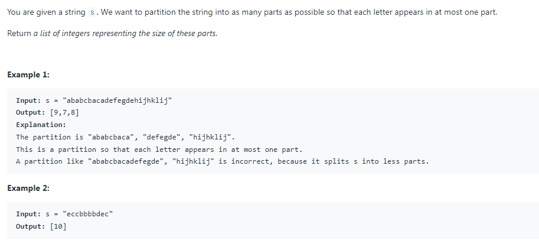

[https://leetcode.com/problems/partition-labels/](https://leetcode.com/problems/partition-labels/)

[Partition Labels - LeetCode](https://leetcode.com/problems/partition-labels/)



문제의 첫 번째 예시에서(ababcbacadefegdehijhklij)

제일 처음 알파벳인 a를 자르려면 최소 \[8\]까지는 한 파트로 묶어 잘라야 나머지 파트에 a가 포함되지 않는다.

그렇게 0~8까지를 한 파트로 묶으면 그 안의 알파벳들 중 나머지 부분에 포함되는 알파벳은 하나도 없다.

그러니 이 컷팅은 성공적이다.

**ababcbaca** defegdehijhklij

그럼 나머지 defegdehijhklij 에서는 d를 자르고 싶다면 **defegd**ehijhklij 만큼을 한 파트로 잘라야 한다.

하지만 그 다음인 e는 **defegde**hijhklij 까지 1만큼 더 추가해서 잘라야 나머지에 e가 포함되지 않는다.

이렇게 자르면 그 사이에 있는 알파벳들이 나머지 부분인 hijhklij에 포함되지 않는 성공적인 커팅이 된다. **ababcbaca** **defegde** hijhklij

나머지 부분인 hijhklij도 같은 방식을 적용해보면 여기선 자를 수 있는 게 없다.

**ababcbaca** **defegde hijhklij**

그래서 최종 결과는 위와 같다.

여기서 어떤 알파벳까지를 자르려면 그 알파벳과 같은 알파벳이 나머지 부분(뒤)에 포함되는지 알아야 한다.

가장 마지막에 나오는 알파벳까지 포함해서 묶어 잘라야 하기 때문이다.

```python
class Solution:
    def partitionLabels(self, s: str) -> List[int]:
        lastIdx = {}
        for i in range(len(s)):
            lastIdx[s[i]] = i

        slices = []
        tempMax = 0  # lastIdx[s[0]]  # 더 큰 idx가 나오기 전까지 임시 저장
        start = 0

        # 현위치보다 마지막 등장 위치가 크면 적어도 거까진 가야해
        for i in range(len(s)):
            alpha = s[i]
            lastAppearIdx = lastIdx[alpha]
            if i <= lastAppearIdx:
                tempMax = max(tempMax, lastAppearIdx)
                if tempMax == i:  # 임시저장했던 최고idx랑 현위치 같으면 자를수있음
                    slices.append(i+1 - start)  # 알파벳 몇개 들어가나
                    start = i + 1  # 다음 조각의 시작위치 갱신

        return slices
```

그렇기 때문에 딕셔너리에 마지막으로 나오는 알파벳의 위치만 저장한다.

가장 마지막 위치가 저장되어있는 이 딕셔너리를 참고해서 잘라야 하는 위치를 구할 것이다.

아까 보았던 예시는 딕셔너리에 &amp;#123;'a': 8, 'b': 5, 'c': 7, 'd': 14, 'e': 15, 'f': 11, 'g': 13, 'h': 19, 'i': 22, 'j': 23, 'k': 20, 'l': 21&amp;#125; 가 저장된다.

마지막 출현 인덱스를 임시로 갖고 있다가 그 임시 값보다 더 큰 인덱스가 나오면 갱신해준다.

적어도 14번까지는 잘라야 했었지만 그보다 더 뒤인 15번에 알파벳이 나오면 15번까지로 잘라야 하기 때문이다.

하지만 여기서 현재 인덱스와 잘라야 하는 최소 인덱스가 같지 않다면 아직 나머지 부분을 다 확인한 게 아니란 뜻이니 현재 위치가 자를 수 있는 인덱스에 도달할 때까지 기다린다.

\*예를 들어 인덱스 9번에서는 자를 수 있는 최소 인덱스가 14였는데 현재 인덱스가 10이 되었을 때는 자를 수 있는 최소 인덱스가 15가 되었다면 10~15 사이에 또 자를 수 있는 최소 인덱스가 갱신될 수도 있는 일이다.

현재 위치가 자를 수 있는 최소 인덱스에 도달했다면 이제는 진짜 잘라도 된다는 뜻이다.

기록해두었던 이번 파트의 시작 위치를 현재 위치에서 빼주어 몇 개의 알파벳을 묶을 수 있는지 알아낸다.
