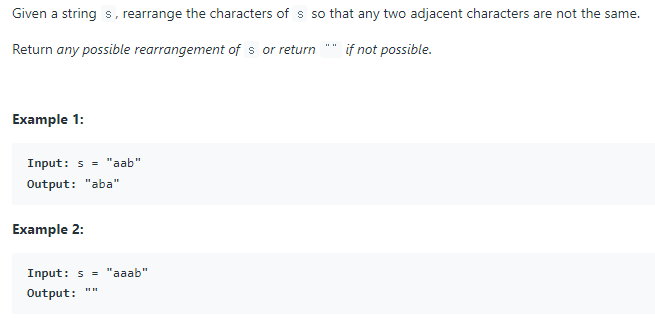

[https://leetcode.com/problems/reorganize-string/](https://leetcode.com/problems/reorganize-string/)

[Reorganize String - LeetCode](https://leetcode.com/problems/reorganize-string/)



주어진 s를 붙어있는 문자들이 겹치치 않도록 재 정렬하는 문제이다.

\==풀이==

-   각 문자의 빈도수 구해서 딕셔너리를 내림차순 정렬
-   answer에 \[0\]부터 2씩 건너뛰며 단어 입력. 끝까지 돌았다면 이번엔 \[1\]부터 단어 입력
-   \* 만약 최대 빈도수 값이 s의 총개수보다 크다면 한 바퀴를 돌고 맨 앞 문자랑 만난단 뜻이므로 실패

```python
class Solution:
    def reorganizeString(self, s: str) -> str:
        answer = [''] * len(s)
        freq = {}
        for ss in s:
            if ss in freq: freq[ss] += 1
            else: freq[ss] = 1

        sort = sorted(freq.items(), key=lambda x: x[1], reverse=True)  # 밸류 기준 정렬

        if sort[0][1] > ceil(len(s) / 2): return ''  # 실패

        i = 0
        for key, val in sort:
            while freq[key] > 0:
                answer[i] = key
                i += 2
                freq[key] -= 1
                if i >= len(answer): i = 1

        return ''.join(answer)
```
