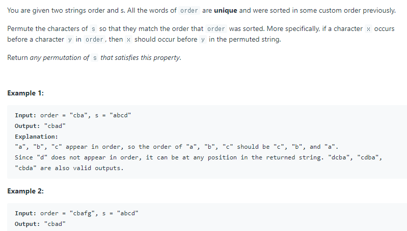

[https://leetcode.com/problems/custom-sort-string/](https://leetcode.com/problems/custom-sort-string/)

[Custom Sort String - LeetCode](https://leetcode.com/problems/custom-sort-string/)



우선 s의 문자들 중 order에 존재하는 문자를 order에서의 정렬 순서대로 정렬한 후 나머지 문자를 s에 있던 순서대로 정렬한다.

여기서 주의해야 할 점은 order는 모든 문자가 유니크하지만 s는 중복이 허용되기 때문에 s에 있는 모든 중복 문자는 order에 있는 순서대로 정렬되어야 한다는 것이다.

order = "kqep", s  = "pekeq" 라면 결과는 "kqeep"가 되어야 한다.

```python
class Solution:
    def customSortString(self, order: str, s: str) -> str:
        ordered = []
        rest = []
        freq = {}

        # 중복 알파벳 추가 위해 빈도구함
        for ss in s:
            if ss in freq: freq[ss] += 1
            else: freq[ss] = 1

        # 먼저 order에 있는 문자가 s에 있는 경우부터 조사
        for o in order:
            idx = s.find(o)
            if idx > -1:
                ordered.extend([o] * freq[o])

        # order에는 없고 s에만 있는 문자 조사
        for ss in s:
            idx = order.find(ss)
            if idx == -1:
                rest.append(ss)

        return ''.join(ordered+rest)
```

딕셔너리 자료구조 freq에 s의 문자 빈도수를 구해서 저장한다.

order의 문자를 s에 존재하는지 find()로 찾아서 존재한다면 아까 구한 빈도수만큼 ordered에 추가한다.

다음으로 s에만 존재하는 문자를 찾기 위해 역시 find()로 order에 존재하는지 확인해서 존재하지 않는 문자라면 rest에 추가한다.

마지막에는 문자열로 정답을 반환해준다.
