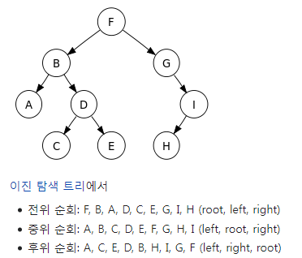

[https://ko.wikipedia.org/wiki/%ED%8A%B8%EB%A6%AC\_%EC%88%9C%ED%9A%8C](https://ko.wikipedia.org/wiki/%ED%8A%B8%EB%A6%AC_%EC%88%9C%ED%9A%8C)

[트리 순회 - 위키백과, 우리 모두의 백과사전](https://ko.wikipedia.org/wiki/%ED%8A%B8%EB%A6%AC_%EC%88%9C%ED%9A%8C)

현재 노드를 몇번째에 방문하느냐로 전위, 중위, 후위가 정해진다고 생각하면 편하다.



**전위 순회**(preorder) (=깊이 우선 순회(depth-first traversal))

1.  노드를 방문한다.
2.  왼쪽 서브 트리를 전위 순회한다.
3.  오른쪽 서브 트리를 전위 순회한다.

```python
    def preorderTraversal(self, root: Optional[TreeNode]) -> List[int]:
        result = []
        stack = [root]
        while stack:
            node = stack.pop()
            if node:
                result.append(node.val)  # 현재 값을 취하고
                stack.append(node.right)  # 나중에 꺼내져야할 오른쪽 먼저 스택에
                stack.append(node.left)
        return result
```

**중위 순회**(Inorder) (=대칭 순회(symmetric))

1.  왼쪽 서브 트리를 중위 순회한다.
2.  노드를 방문한다.
3.  오른쪽 서브 트리를 중위 순회한다.

```python
    def inorderTraversal(self, root: TreeNode) -> List[int]:
        stack,result = [],[]
        node = root
        while node or stack:
            while node:  # 왼쪽으로 먼저 탐색하며 서브노드를 계속 누적
                stack.append(node)
                node = node.left
            node = stack.pop()
            result.append(node.val)
            node = node.right  # 오른쪽 값. fullnode면 젤 첨에는 null일거임
        return result
```

**후위 순회**(postorder)

1.  왼쪽 서브 트리를 후위 순회한다.
2.  오른쪽 서브 트리를 후위 순회한다.
3.  노드를 방문한다.

```python
    def postorderTraversal(self, root: Optional[TreeNode]) -> List[int]:
        result = []
        stack = [root]
        while stack:
            node = stack.pop()
            if node:
                result.append(node.val)  # 맨 나중에 올 거 먼저 넣음(반대순서로 출력할거니까)
                stack.append(node.left)  # 왼쪽이 맨 첨에 와야함. 근데 반대순서로 할거니까 먼저 넣어서 나중에 나오도록
                stack.append(node.right)
        return result[::-1]
```

\[알고리즘\]

전위 순회:

[https://leetcode.com/problems/binary-tree-preorder-traversal/](https://leetcode.com/problems/binary-tree-preorder-traversal/)

중위 순회:

[https://leetcode.com/problems/binary-tree-inorder-traversal/](https://leetcode.com/problems/binary-tree-inorder-traversal/)

후위 순회:

[https://leetcode.com/problems/binary-tree-postorder-traversal/](https://leetcode.com/problems/binary-tree-postorder-traversal/)
