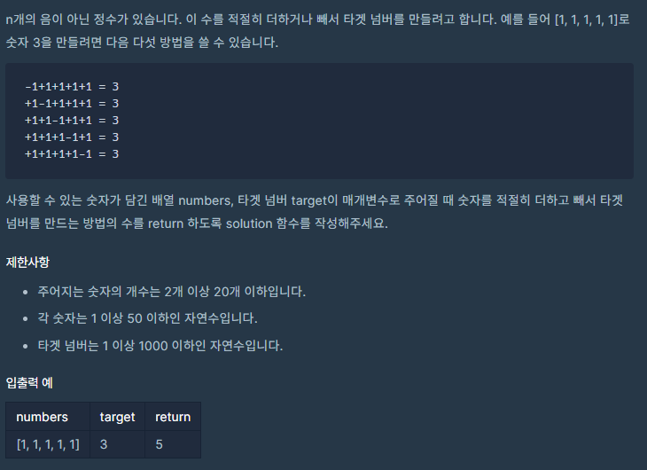

[https://programmers.co.kr/learn/courses/30/lessons/43165](https://programmers.co.kr/learn/courses/30/lessons/43165)

[코딩테스트 연습 - 타겟 넘버](https://programmers.co.kr/learn/courses/30/lessons/43165)



처음부터 하나씩 더하고 빼는 경우의 수를 다 구하는 건 비효율적이란 생각이 들어서 반대로 생각해보았다.

숫자들을 전부 더한 다음 거기서 타겟이 되도록 빼는 것이다.

숫자들의 총합은 (타겟이 되기 위한 숫자들 + 잉여 숫자들)이기 때문에 잉여 숫자들의 조합 경우의 수를 구하는 게 답을 구하는 거나 마찬가지이다.

총합에서 뺐을 때 타겟을 만들어주는 숫자가 k라고 해보자.

만약 numbers = \[3,3,3,1,1\] 일 때 target = 7이면 총합은 11이고 타겟은 7이니까 k는 4다.

잉여 숫자는 \[1,1\]인데 이걸 보면 k에서 반을 나눈 숫자가 numbers에서 구해야 하는 숫자 조합의 합계란 걸 알 수 있다.

총합계는 (이미 더해진 어떤 숫자 + 그 숫자를 뺐다면 생겼을 차이)이다.

그래서 이미 플러스 부호로 계산한 그 숫자가 마이너스 부호였다고 가정한다면 총합에서 두 번을 빼줘야 하기 때문에 k÷2를 해주는 것이다.

잉여 숫자의 합인 새로운 타겟 숫자를 구했다면 그다음은 재귀 함수를 이용해 경우의 수를 구하면 된다.

▼이 부분은 전에 풀었던 알고리즘 문제와 로직이 비슷하다.

[2021.09.02 - \[알고리즘\] - \[Python\] 리트코드 216. Combination Sum III](https://bomoto.tistory.com/48)

[Python 리트코드 216. Combination Sum III](https://bomoto.tistory.com/48)

\==정리==

-   numbers의 합계에서 주어진 타겟 숫자를 빼면 numbers에서 target이 되는 데에 필요 없는 잉여 값을 알 수 있음
-   잉여 값은 (합계-타겟)/2로 구함
-   잉여 값이 나오도록 numbers에서 조합 경우의 수를 찾으면 됨

\==코드==

```python
def solution(numbers, target):
    answer = 0
    overVal = (sum(numbers) - target)//2  # 잉여 값 구하기. 이 값을 만들 경우의 수를 구해야함
    length = len(numbers)

    def recursive(target, idx, cnt):  # 목표 숫자, 리스트에서 현재 위치, 경우 갯수
        for i in range(idx, length):
            temp = target
            temp -= numbers[i]
            if temp == 0:
                cnt += 1
            elif temp > 0:
                cnt += recursive(temp, i+1, 0)
            elif temp < 0:
                continue
        return cnt

    return recursive(overVal, 0, 0)
```
