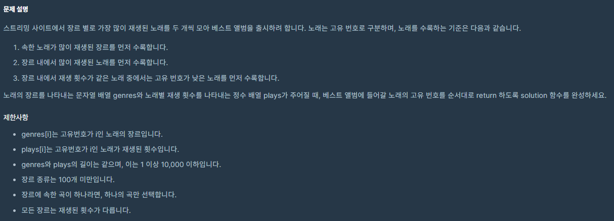

[https://programmers.co.kr/learn/courses/30/lessons/42579](https://programmers.co.kr/learn/courses/30/lessons/42579)

[코딩테스트 연습 - 베스트앨범](https://programmers.co.kr/learn/courses/30/lessons/42579)



```python
import collections

def solution(genres, plays):
    answer = []

    # 1
    sumOfGenres = collections.defaultdict(int)  # 장르별 총 재생 횟수
    playsListDict = collections.defaultdict(list)  # 장르별로 나눠서 재생횟수와 인덱스 리스트로 저장

    # 2
    for i, genre, play in zip(range(len(genres)), genres, plays):
        sumOfGenres[genre] += play
        playsListDict[genre].append([i, play])  # 장르(키)의 밸류에 리스트를 계속 추가함: [인덱스, 재생횟수] 형태

    # 3
    items = sorted(sumOfGenres.items(), key=lambda x: x[1], reverse=True)  # 밸류기준 내림차순 정렬

    # 4
    for key, val in items:
        # 4-1
        # 해당 장르의 (인덱스, 재생횟수)를 재생횟수 기준 정렬
        playTimes = sorted(playsListDict[key], key=lambda x: x[1], reverse=True)
        # 4-2
        for idx, play in playTimes[:2]:
            answer.append(idx)

    return answer
```

#1

정렬 기준은 세 가지이다.

1.  재생 횟수 합계가 많은 장르
2.  그 장르 내 재생 횟수가 많은 곡
3.  고유 번호가 낮은 곡

정렬 조건 2, 3번은 재생 횟수와 인덱스를 함께 저장해서 해결하면 되지만 1번까지 고려한다면 딕셔너리가 2개 필요해진다.

#2

딕셔너리 sumOfGenres:

일단은 재생 횟수 합계가 많은 장르를 알아야 그 장르 안에서 또 정렬을 할 수 있기 때문에 장르별 총 재생 횟수 딕셔너리를 만든다.

여기에는 키값은 장르, 밸류는 재생 횟수가 저장된다.

반복문으로 장르와 재생시간을 가져와 해당 키 값이 이미 저장된 적이 없다면 새로 추가하고 저장된 적이 있다면 기존 값에 더해준다. (코드에선 collections.defaultdict를 사용해 이 과정을 줄였음)

딕셔너리 playsListDict:

그리고 장르 별 재생 횟수를 알아야 그 고유번호를 리턴할 수 있기 때문에 장르별 재생 횟수 딕셔너리에도 데이터를 넣어준다.

키값에는 장르를 밸류에는 고유번호(인덱스)와 재생 횟수를 리스트 형태로 추가시켜준다.

#3

데이터를 다 추가했다면 이제 재생 횟수가 가장 많은 장르를 알아야 한다.

총 재생 횟수가 저장된 딕셔너리를 밸류(총 재생 횟수) 기준 내림차순 정렬해 items에 저장한다.

#4

items를 반복문으로 key, value를 하나씩 꺼내어 재생 횟수가 많은 순서대로 장르를 가져올 차례이다.

#4-1

items의 키값(장르)은 playsListDict에서도 키값이니 해당 장르에 리스트로 저장했던 고유번호와 재생 횟수들을 가져온다.

이 데이터를 밸류 기준(재생 횟수)으로 내림차순 정렬해 playTimes에 저장한다.

#4-2

한 장르에는 2개의 곡만 수록한다고 했으니 \[:2\]에 해당하는 데이터만 반복문을 돌린다.

여기서 고유번호인 idx를 answer에 추가해주면 된다.

```python
import collections

def solution(genres, plays):
    answer = []

    sumOfGenres = collections.defaultdict(int)
    playsListDict = collections.defaultdict(list)

    for i, genre, play in zip(range(len(genres)), genres, plays):
        sumOfGenres[genre] += play
        playsListDict[genre].append([i, play])

    items = sorted(sumOfGenres.items(), key=lambda x: x[1], reverse=True)

    for key, val in items:
        playTimes = sorted(playsListDict[key], key=lambda x: x[1], reverse=True)
        for idx, play in playTimes[:2]:
            answer.append(idx)

    return answer
```
