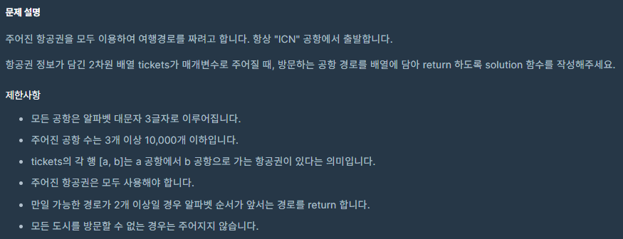

[https://programmers.co.kr/learn/courses/30/lessons/43164](https://programmers.co.kr/learn/courses/30/lessons/43164)

[코딩테스트 연습 - 여행경로](https://programmers.co.kr/learn/courses/30/lessons/43164)



### Caution.

만약 A에서 시작해서 갈 수 있는 공항이 B와 C가 있다고 해보자.

여기까지만 봤을 때는 당연히 알파벳 앞 순서인 B공항으로 가야 하겠지만 B공항으로 갔을 때 그곳에서 갈 수 있는 다음 공항이 없다면 A에서 C로 갔어야 한다.

때문에 출발지가 동일한 티켓 중 도착지의 알파벳 순서가 앞이라고 해서 그 공항으로 무조건 여행하면 안 된다.

### Main Idea.

티켓을 알파벳순으로 정렬한 후 순서대로 탐색해서 도착한 곳이 유효한 루트면(그 공항이 다음 출발지가 될 수 있다면) 해당 루트로 여행, 아니라면 다시 돌아와 그다음 티켓으로 여행한다.

```python
def solution(tickets):
    # 1. 출발지로 1차 정렬, 도착지로 2차 정렬
    tickets.sort(key=lambda x: (x[0], x[1]))

    # 3. 여행 루트 반환 함수. 파라미터:(남은 티켓, 현재까지의 여행 루트)
    def canTravel(tickets, route):
        # 3-2-1 성공
        if len(tickets) == 0: return route
        # 3-1
        i = 0
        while i<len(tickets) and tickets[i][0] != route[-1]: i += 1  # 지나온루트중 현위치가 tickets에 몇번째있나
        # 3-2-2 실패
        if i == len(tickets): return []  # 현재 위치가 티켓에 없다면 이 루트는 실패한 루트

        # 3-2
        while tickets[i][0] == route[-1]:  # 티켓의 출발지가 현재 공항이랑 같으면
            res = canTravel(tickets[:i] + tickets[i + 1:], route + [tickets[i][1]])
            # 결과 확인
            if res != []: return res  # 실패한 루트면 3-2-2에서 []를 반환 => 다음티켓을 탐색
            i += 1
        return res

    # 2.
    route = ['ICN']  # 현재까지의 여행루트. 처음은 ICN
    res = canTravel(tickets, route)

    return res
```

### Detail.

1.

티켓을 출발지 기준 1차 정렬, 도착지 기준 2차 정렬한다.

이는 현재 공항에서 갈 수 있는 도착지들을 알파벳 순서대로 체크하기 위해서이다.

2.

출발은 무조건 ICN이니까 현재까지의 루트가 저장될 route에 'ICN'을 담고 canTravel함수를 실행한다.

3.

이 함수는 (현재 가지고 있는 티켓, 현재까지의 여행 루트)를 받아서 새로운 여행 루트를 반환한다.

이제 할 일은 현재 공항에서 다음 공항으로 이동하는 것이다.

현재 내가 있는 공항과 티켓의 출발 공항이 일치하는 티켓을 사용할 것이다.

3-1.

몇 번째 인덱스의 티켓이 사용할 수 있는지 알기 위해 3-1의 while문을 돌린다.

route에는 지금까지의 여행 경로가 저장되어 있으니 가장 마지막 요소가 현재 내가 있는 공항일 것이다.

그러니 tickets을 처음부터 확인해서 티켓의 출발지가 현재 위치와 동일할 때까지 i를 증가시킨다.

이 반복문이 종료되면 i에는 사용 가능한 티켓이 저장된 최초 인덱스가 저장된다.

3-2.

다음으로 3-1에서 찾은 i를 이용해 출발지가 현재 위치랑 같은 티켓을 차례로 검사한다.

tickets에서는 현재 사용한 티켓을 빼고 route에는 사용한 티켓의 도착지를 추가해 canTravel을 재귀적으로 실행한다.

3-2-1) 이 루트가 유효한 루트라면(=티켓을 사용했을 때 모든 여행지를 갈 수 있다면 =tickets의 길이가 0이면) 다른 경우의 수는 체크할 필요 없이 바로 해당 루트를 정답으로 반환한다.

3-2-2) 현재 내가 있는 공항이 남은 티켓들의 출발지에 없다면 다른 공항으로 갈 수 없다. 따라서 이 루트는 실패한 루트이다. 다시 3-2의 while문으로 돌아가 다음번 티켓으로 여행해본다.
