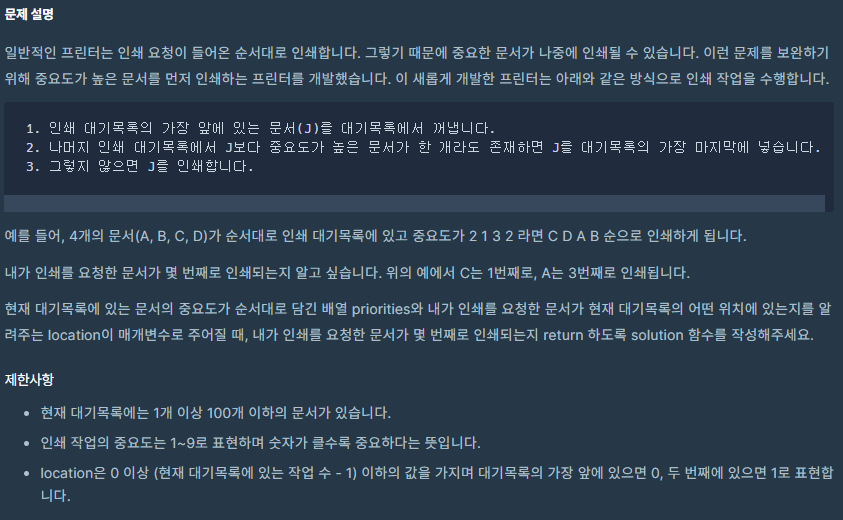

NWERC 2006 (Northwestern European Programming Contest)문제

[programmers.co.kr/learn/courses/30/lessons/42587](https://programmers.co.kr/learn/courses/30/lessons/42587)

[코딩테스트 연습 - 프린터](https://programmers.co.kr/learn/courses/30/lessons/42587)



\==풀이==

딕셔너리에 문서의 인덱스와 그 문서의 우선순위를 저장한다.

우선순위의 최댓값을 구하고 나서 우선순위가 담긴 priorities배열을 하나씩 확인한다.

어떤 문서의 우선순위가 구했던 최댓값이랑 동일하면 그 문서를 출력해야 한다.

출력된 문서 개수를 1 더해주고 출력했다는 뜻으로 우선순위를 0으로 바꾸어준다. (문제에서 주어지는 우선순위는 1~9로만 표현되는 것 참고)

현재 검사하고 있는 문서가 내가 알고자 하는 문서라면 바로 함수를 종료해주면 되고 아니라면 최대 우선순위 값은 이미 출력되었으니 새로 최댓값을 구해서 다시 반복문을 돌린다.

  - 딕셔너리에 \[문서의 인덱스, 우선순위\] 저장

  - 우선순위 최댓값 구하기

1.  우선순위 담긴 배열 priorities 반복
2.  현재 문서의 우선순위가 최댓값 && 현재 idx == 알려는 문서 위치(location)  => 반복문 종료
3.  현재까지의 출력 문서 수 리턴

\==코드==

```python
def solution(priorities, location):
    answer = 0  # 출력된 문서의 수
    prioDict = {}  # [문서 인덱스:그 문서 우선순위]

    # 각 문서의 인덱스와 우선순위를 저장
    for i, prio in enumerate(priorities):
        prioDict[i] = prio

    maxNum = max(prioDict.values())  # 최대값 구함

    while priorities[location] != 0:  # 값이 0이면 이미 출력된 문서. 찾으려는 문서가 출력되기 전까지 반복
        for i in prioDict:
            if prioDict[i] == maxNum:
                answer = answer + 1  # 출력문서수 +1

                if i == location:  # 이번 출력문서가 알고자 하는 문서라면 종료
                    return answer

                prioDict[i] = 0  # 출력된 문서는 우선순위 0으로 바꿔줌
                maxNum = max(prioDict.values())  # 알고자하는 문서 아니었다면 최대값 새로 구해주고 다시 반복
```
