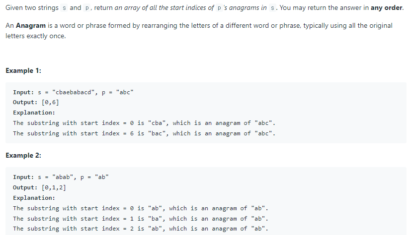

[https://leetcode.com/problems/find-all-anagrams-in-a-string/](https://leetcode.com/problems/find-all-anagrams-in-a-string/)

[Find All Anagrams in a String - LeetCode](https://leetcode.com/problems/find-all-anagrams-in-a-string/)



s에서 p의 anagram이 시작하는 위치들의 리스트를 정답으로 리턴한다.

\==풀이==

이런 문제같이 일정 범위 내에서 뭔가를 체크해 나가는 건 sliding window로 풀면 좋다.

s와 p를 알파벳 개수 26개만큼 리스트를 만들어서 여기에 빈도수를 체크할 것이다.

gap에는 window의 크기를 정해주고 이 gap 만큼씩 이동할 것이다.

-   비교 대상인 p의 길이만큼 s와 p를 아스키코드를 이용해 빈도수를 저장해준다.
-   s의 나머지 문자들을 검사해서 새로 문자의 빈도수를 추가하고 그만큼 이전에 추가한 문자를 빈도수에서 빼준다.
-   체크하면서 s와 p의 빈도수가 같다면 인덱스를 정답에 추가해준다.

```python
class Solution:
    def findAnagrams(self, s: str, p: str) -> List[int]:
        answer = []
        if len(s) < len(p): return answer
        pList = [0] * 26
        sList = [0] * 26
        gap = len(p)

        # p의 길이만큼 돌려서 샘플 만들고(p) s도 그만큼 이동
        for i in range(gap):
            sList[ord(s[i])-97] += 1
            pList[ord(p[i])-97] += 1

        # 이번에는 이동하는만큼 맨 앞 문자는 빼줌
        for i in range(gap, len(s)):
            if pList == sList:
                answer.append(i-gap)
            sList[ord(s[i])-97] += 1
            sList[ord(s[i-gap])-97] -= 1

        # 위 for문에서 먼저 비교한다음 증감하기 때문에
        # 마지막에 한번 더 검사해주기
        if pList == sList:
            answer.append(i+1-gap)

        return answer
```
