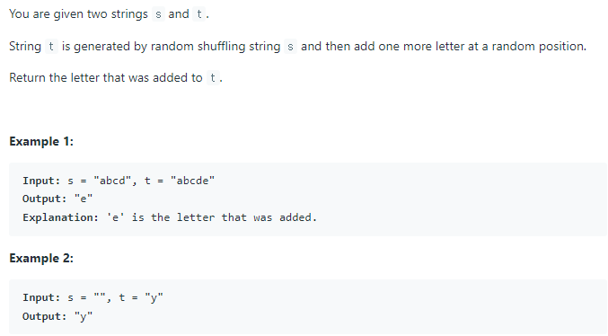

[https://leetcode.com/problems/find-the-difference/](https://leetcode.com/problems/find-the-difference/)

[Find the Difference - LeetCode](https://leetcode.com/problems/find-the-difference/)



문제를 풀다가 풀이 방법이 이마를 탁 치게 만들어서 가져와봤다.

딕셔너리로 빈도수를 체크해서 풀어야 하나 고민하고 있었는데 의외로 쉽게 풀 수 있단 걸 알게 되었다.

s와 t의 모든 문자가 똑같은데(예시에는 나와있지 않지만 s와 t의 문자들은 순서가 다를 수도 있다.) 단 한 가지만 t에 추가된 상태이다.

그러니 s와 t의 각각 변수를 선언해서 아스키코드로 변환한 알파벳들을 모두 더해준 뒤 t에서 s를 빼주면 t에만 추가된 그 알파벳의 아스키코드를 알 수 있다.

&lt;Python>

```python
class Solution:
    def findTheDifference(self, s: str, t: str) -> str:
        ascS = 0
        ascT = ord(t[-1])  # 마지막 문자 미리 계산(for문에서 하나가 안돌기때문)
        for i in range(len(s)):
            ascS += ord(s[i])
            ascT += ord(t[i])
        return chr(ascT - ascS)  # t의 아스키코드 합계에서 s합계를 빼준걸 다시 문자로 변환
```

&lt;JavaScript>

```javascript
/**
 * @param {string} s
 * @param {string} t
 * @return {character}
 */
var findTheDifference = function(s, t) {
    let ascS = 0;
    let ascT = t.charCodeAt(t.length-1);
    for(let i=0; i<s.length; i++){
        ascS += s.charCodeAt(i);
        ascT += t.charCodeAt(i);
    }
    return String.fromCharCode(ascT - ascS);
};
```

어렵지는 않은 문제지만 적절한 방법은 쓰면 문제를 훨씬 더 쉽게 풀 수 있다.
