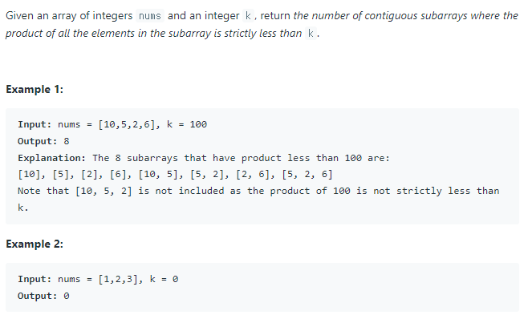

[https://leetcode.com/problems/subarray-product-less-than-k/](https://leetcode.com/problems/subarray-product-less-than-k/)

[Subarray Product Less Than K - LeetCode](https://leetcode.com/problems/subarray-product-less-than-k/)



nums의 부분 배열이 k보다 작은 경우의 수를 구하는 문제.

\==풀이==

슬라이딩 윈도우 알고리즘을 이용한다.

start와 end 두 가지 포인터를 선언하고 부분 배열의 곱이

k를 안 넘었다면 end를 증가시키고

k를 넘었다면 k이하가 될 때까지 start를 감소 & 맨 앞에 곱해준 값은 나눠준다.

문제의 1번 예시에서처럼 내가 찾은 부분 배열이 \[5, 2\] 였을 때 cnt를 1만 증가시키면 안 된다.

지금 찾은 부분 배열이 k 이하라는 뜻은 \[5, 2\]의 곱이 k미만이란 뜻이기 때문에 \[5\]도 결과에 더해줘야 한다.

따라서 cnt에 경우의 수를 더할 때에는 end - start의 값으로 증가시켜준다.

현재 end까지 검사한 부분 배열이 k보다 작다는 것은 start이후에 어디를 시작 위치로 잡든 k보다 작을 것이기 때문이다.

```python
class Solution:
    def numSubarrayProductLessThanK(self, nums: List[int], k: int) -> int:
        start = 0
        end = 0
        product = 1
        cnt = 0

        while end < len(nums):
            product *= nums[end]
            while product >= k and start <= end:
                product //= nums[start]
                start += 1
            cnt += (end+1 - start)  # [end]가 k이하면 그 앞에 어디서 시작하든 전부 k이하니까. 모든 start위치를 다 더해주는거
            end += 1

        return cnt
```

\*참고: 이 문제의 합계 버전

[https://leetcode.com/problems/minimum-size-subarray-sum/](https://leetcode.com/problems/minimum-size-subarray-sum/)

[Minimum Size Subarray Sum - LeetCode](https://leetcode.com/problems/minimum-size-subarray-sum/)

```python
class Solution:
    def minSubArrayLen(self, target: int, nums: List[int]) -> int:
        start = 0
        end = 0
        sums = 0
        minLen = len(nums) + 1

        while end < len(nums):
            sums += nums[end]
            while sums >= target:
                minLen = min(minLen, end-start+1)
                sums -= nums[start]
                start += 1
            end += 1

        return minLen if minLen < len(nums)+1 else 0
```
