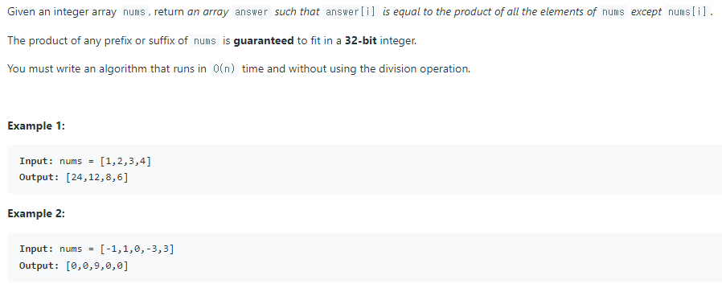

[https://leetcode.com/problems/product-of-array-except-self/](https://leetcode.com/problems/product-of-array-except-self/)

[Product of Array Except Self - LeetCode](https://leetcode.com/problems/product-of-array-except-self/)



answer의 \[i\]에는 자기 자신을 제외한 숫자를 모두 곱한 값이 저장되어야 한다.

그러면 i일 때 곱해주는 값은 nums \[:i\]와 nums \[i+1:\]으로 구분해서 생각할 수 있다.

다시 말해 나를 기준으로 앞부분과 뒷부분으로 나눠서 누적 곱을 구한다는 뜻이다.

앞부분과 뒷부분은 방향만 다르고 로직은 동일하다.

앞부분을 기준으로 로직을 설명해보자면

\[1,2,3,4\]가 있을 때 맨 처음인 1은 앞부분이 존재하지 않는다.

인덱스 \[1\]은 앞부분으로 (1)을 계산해줘야 하고 \[2\]는 앞부분으로 (1X2)를, \[3\]은 (1X2X3)을 계산해줘야 한다.

그러니 i를 증가시키면서 앞부분을 누적곱으로 계산해주는 변수를 하나 만든다.

i가 증가할 때마다 이 누적곱에 i를 곱해주고 answer에는 누적곱값을 곱해준다.

반복문을 전부 돌고 나면 answer는 앞부분만을 계산한 값들이 저장되어있다.

이와 같은 방법으로 거꾸로 반복문을 돌면서 뒷부분 누적곱을 계산해주면 원하는 답을 얻을 수 있다.

앞부분과 뒷부분을 나눠서 계산해도 되지만 효율성을 위해 하나의 반복문으로 앞부분과 뒷부분을 계산하였다.

```python
class Solution:
    def productExceptSelf(self, nums: List[int]) -> List[int]:
        n = len(nums)
        answer = [1] * len(nums)
        front = 1
        back = 1
        for i in range(n):
            answer[i] *= front
            answer[n-1-i] *= back
            front *= nums[i]
            back *= nums[n-1-i]

        return answer
```
