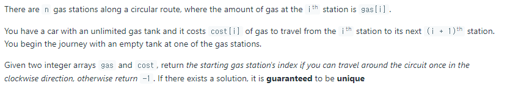
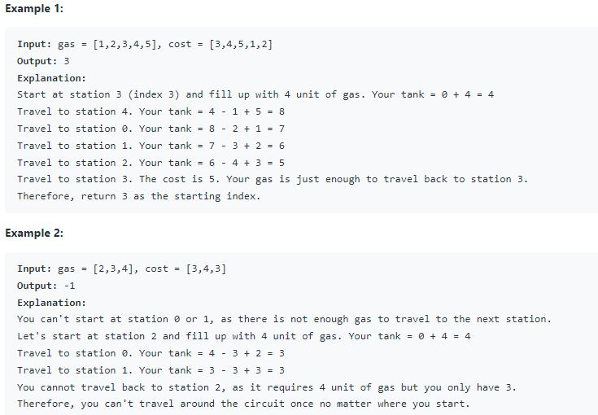

[https://leetcode.com/problems/gas-station/](https://leetcode.com/problems/gas-station/)

[Gas Station - LeetCode](https://leetcode.com/problems/gas-station/)





\==풀이==

이 문제를 그리디 알고리즘으로 풀 수 있다는 걸 안다면 좀 더 쉽게 풀 수 있다.

현재 gas station에서 다음 gas station으로 넘어가기 위해서는 소비해야 하는 gas보다 충전된 gas가 더 많아야 한다.

충전된 gas는 이전부터 누적된 상태이다.

그러므로 처음 시작하는 gas station의 위치는 초반에 충전되는 gas가 가장 많을 수 있는 위치여야 한다.

따라서 gas station에 들를 때마다 얻을 수 있는 gas를 계속 누적하고

누적 gas가 가장 적은 station이 가장 많은 gas를 소비한다는 뜻이니까

이 바로 다음 station에서 출발한다면 초반에 가장 많은 gas를 충전하면서 이동할 수 있다.

그러면 중간에 gas가 없어서 다음 station으로 이동하지 못할 일이 없을 것이다.

정리하자면
  - cost와 gas를 따져서 가장 적게 이득 보는 station을 찾음.
  - 그곳을 가장 마지막에 들러야 함

```python
class Solution:
    def canCompleteCircuit(self, gas: List[int], cost: List[int]) -> int:
        minCurr = gas[0]-cost[0]  # 이익이 젤 작은 누적 값 저장
        idx = 0  # 젤 작은 순간의 가스 인덱스 저장
        totalGas = 0  # 현재까지의 가스

        for i in range(len(gas)):
            currProfit = gas[i] - cost[i]  # 현재 턴 이득본 가스
            totalGas += currProfit
            if totalGas < minCurr:
                minCurr = totalGas
                idx = i

        if totalGas < 0: return -1
        return idx+1 if idx+1<len(gas) else 0
```
