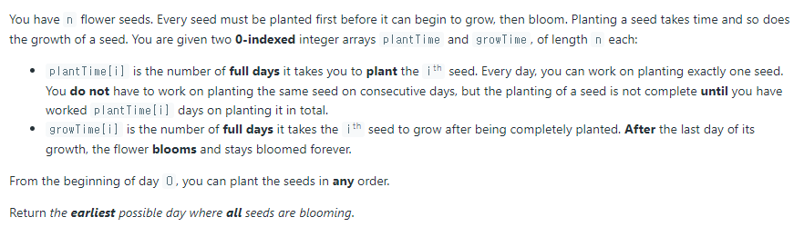
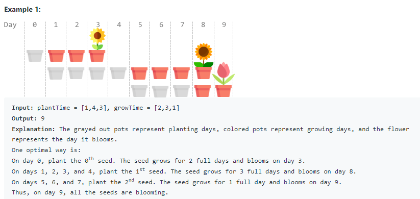
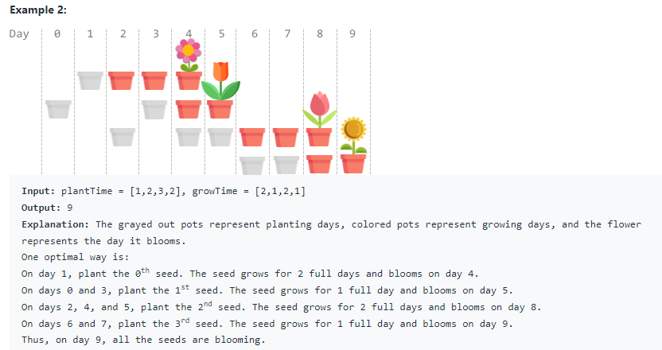

[https://leetcode.com/problems/earliest-possible-day-of-full-bloom/](https://leetcode.com/problems/earliest-possible-day-of-full-bloom/)

[Earliest Possible Day of Full Bloom - LeetCode](https://leetcode.com/problems/earliest-possible-day-of-full-bloom/)







\==풀이==

이 문제는 그리디 알고리즘으로 푼다면 쉽게 풀 수 있다.

plant 하는 날짜는 각 씨앗들끼리 겹칠 수 없기 때문에 plant 하는 날을 잘 분배해야 한다.

다른 씨앗이 grow 하는 동안 plant 하도록 만들어야 한다.

그렇다면 growTime이 제일 오래 걸리는 씨앗을 먼저 심어서 plant 하는 날짜는 소진시키고 이 씨앗이 자라는 동안 다른 씨앗들을 plant 하고 grow 시키면 된다.

1\. plant와 grow를 짝지어서 이중 배열에 집어넣고 grow의 내림차순으로 정렬한다.

2\. 정렬한 배열을 돌면서 꽃이 핀 최종 날짜인 bloomDay에 해당 씨앗이 만개한 최종 날을 구하여 리턴한다.

    -> 모든 씨앗의 plant는 겹치치 않아야 하니 plantDay에 각 씨앗이 plant 하는 날을 누적시킨다.

    -> bloomDay에는 현재 씨앗까지 누적된 plantDay와 현재 씨앗의 growTime을 더해서 이 값을 이전의 bloomDay와 비교하여 max값을 경신해준다.

```python
class Solution:
    def earliestFullBloom(self, plantTime: List[int], growTime: List[int]) -> int:
        pair = []
        bloomDay = 0
        plantDay = 0
        for i in range(len(plantTime)):
            pair.append([plantTime[i], growTime[i]])

        # grow가 오래걸리는 씨앗을 먼저 심어야
        # 얘가 grow하는 동안 다른애들이 plant할수있음. 그래서 grow기준 역순 정렬
        pair.sort(key = lambda x:x[1], reverse=True)

        for p in pair:
            plantDay += p[0]
            bloomDay = max(bloomDay, plantDay+p[1])  # plant와 grow날짜 합쳐서 bloom구함

        return bloomDay
```
