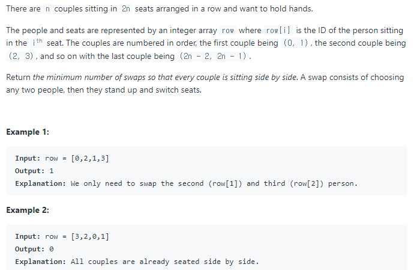

[https://leetcode.com/problems/couples-holding-hands/](https://leetcode.com/problems/couples-holding-hands/)

[Couples Holding Hands - LeetCode](https://leetcode.com/problems/couples-holding-hands/)



\==풀이==

먼저 couple 중 하나의 숫자만 알고 있을 때 나머지 짝의 숫자를 알아내는 방법을 생각해보면 두 가지 조건이 있다.

1\. 두 숫자가 1만 차이 나야 함

2\. 짝수인 숫자보다 홀수인 숫자가 커야 함

위 조건을 정리하면 내가 짝수라면 내 짝은 1만큼 큰 홀수, 내가 홀수라면 내 짝은 1만큼 작은 짝수여야 한다.

이 방법을 이용해 row에서 하나씩 건너뛰며 couple의 왼쪽 사람만 검사하며 그 사람의 짝을 알아낸다.

바로 다음 요소를 확인해서 내 짝이 맞다면 couple을 이뤘으니 넘어가지만 짝이 맞지 않다면 그 뒷 요소들을 확인해서 내 짝을 찾아낸다.

짝을 찾아냈다면 swap 해주고 count를 올려준다.

나는 swap 할 때 내 짝이 잘못 들어가 있던 위치에만 값을 경신해줬다.

내 옆의 요소는 이제 더 이상 확인할 일이 없기 때문에 굳이 나의 맞는 짝으로 바꿔줄 필요가 없기 때문이다.

```python
class Solution:
    def minSwapsCouples(self, row: List[int]) -> int:
        # 올바른 짝 찾아주는 함수
        def getPair(num):
            if num % 2 == 0:
                return num + 1
            else:
                return num - 1

        swap = 0
        for i in range(0, len(row), 2):
            pair = getPair(row[i])
            if pair != row[i+1]:  # 짝이 맞지 않다면? 맞는애 찾아서 바꾸기
                for j in range(i+2, len(row)):
                    if row[j] == pair:
                        row[j] = row[i+1]  # [i]는 굳이 바꿀 필요 없으니 뒤에만 바꿔줌
                        swap += 1
                        break

        return swap
```
