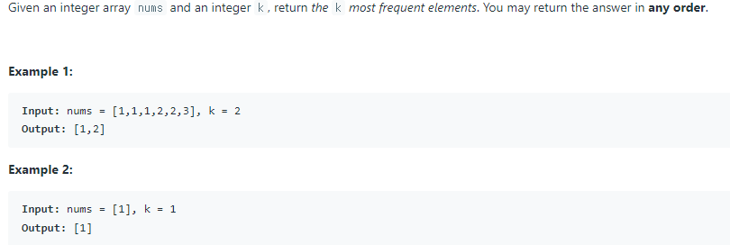

[https://leetcode.com/problems/top-k-frequent-elements/](https://leetcode.com/problems/top-k-frequent-elements/)

[Top K Frequent Elements - LeetCode](https://leetcode.com/problems/top-k-frequent-elements/)



풀이법은 간단하다.

각 빈도수를 체크해서 hash로 저장하고 이걸 빈도수 역순 정렬해서 k개만큼의 키를 반환해주면 된다.

자바스크립트는 map을 활용하고 파이썬은 딕셔너리를 활용하여 풀었다.

각 언어의 문법을 잘 활용할 수 있는 문제이다.

&lt;JavaScript>

```javascript
var topKFrequent = function(nums, k) {
    const map = new Map();
    for(let i=0; i<nums.length; i++){
        map.set(nums[i], (map.get(nums[i]) || 0) + 1);
    }

    const arr = [...map];

    return arr.sort((a,b) => b[1]-a[1]).map((item) => item[0]).slice(0, k)
};
```

&lt;Python>

```python
class Solution:
    def topKFrequent(self, nums: List[int], k: int) -> List[int]:
        freq = {}
        for n in nums:
            if n in freq: freq[n] += 1
            else: freq[n] = 1

        sort = sorted(freq.items(), key=lambda x:x[1], reverse=True)

        answer = []
        for i in range(k):
            answer.append(sort[i][0])

        return answer
```
