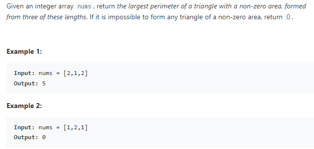
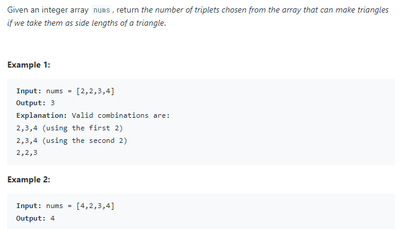

**\[문제 1\]**

[https://leetcode.com/problems/largest-perimeter-triangle/](https://leetcode.com/problems/largest-perimeter-triangle/)

[Largest Perimeter Triangle - LeetCode](https://leetcode.com/problems/largest-perimeter-triangle/)



주어진 nums로 가장 긴 삼각형을 만들 수 있는 조합을 찾아서 그 둘레를 반환하는 문제

삼각형은 가장 긴 변=a, 두 번째 긴 변=b, 제일 짧은 변=c 라고 했을 때 a &lt;b+c여야 한다.

그러니 nums를 정렬한 후 a, b, c 변을 비교해서 조건에 맞으면 세 변의 합을 반환해준다.

&lt;python>

```python
class Solution:
    def largestPerimeter(self, nums: List[int]) -> int:
        sort = sorted(nums, reverse = True)
        for i in range(len(sort) - 2):
            if sort[i] < sort[i+1] + sort[i+2]:
                return sum(sort[i:i+3])
        return 0
```

**\[문제 2\]**

[https://leetcode.com/problems/valid-triangle-number/](https://leetcode.com/problems/valid-triangle-number/)

[Valid Triangle Number - LeetCode](https://leetcode.com/problems/valid-triangle-number/)



문제 1과 비슷한데 이번에는 nums로 삼각형을 만들 수 있는 조합 경우의 수를 반환하는 문제이다.

nums를 내림차순 정렬한 후 이중 반복문으로 외부 반복문에서는 가장 큰 수인 a를 탐색해주고 내부 반복문에서는 b와 c를 탐색해준다.

b는 a의 바로 다음 수부터 체크하고 c는 현재 가능한 변들 중 가장 짧은 변의 인덱스를 잡아서 탐색한다.

만약 현재 선택된 a, b, c 가 삼각형의 조건에 맞는다면 c가 b~c 중 어떤 값으로 변경되건 여전히 조건에 맞는다는 뜻이니 c는 더 이상 탐색할 필요 없이 c-b의 값을 최종 개수에 합해준다.

하지만 a, b, c가 삼각형이 이루어지지 않았다면 가장 짧은 변이었던 c를 더 긴 변으로 변경한 후 삼각형의 조건에 맞는지 확인을 계속해준다.

&lt;JavaScript>

```javascript
var triangleNumber = function(nums) {
    let cnt = 0;
    const len = nums.length;
    nums.sort((a,b)=>b-a);
    for(let a=0; a<len; a++){
        let b = a+1;  // 두번째 큰 수
        let c = len-1;  // 젤 작은 수
        while(b < c){
            if(nums[a] < nums[b]+nums[c]){
                cnt += (c-b);
                b ++;  // 둘째 큰수 더 줄여보기
            }else{
                c --;  // 삼각형 실패면 젤 작은 수 키워보기
            }
        }
    }
    return cnt
};
```
