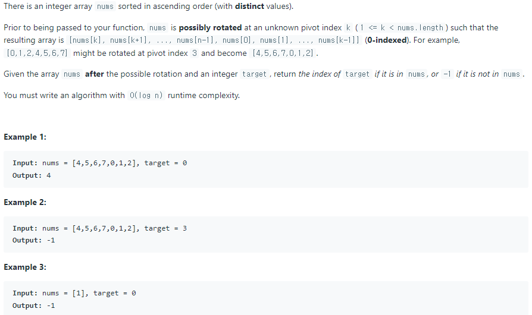

[https://leetcode.com/problems/search-in-rotated-sorted-array/](https://leetcode.com/problems/search-in-rotated-sorted-array/)

[Search in Rotated Sorted Array - LeetCode](https://leetcode.com/problems/search-in-rotated-sorted-array/)



\==풀이==

이진 탐색 알고리즘을 사용하는 문제인데 nums가 k개만큼 로테이션된 상태로 주어진다.

이 문제의 핵심은 binary search 알고리즘을 사용하면서 구하는 mid가 로테이션된 부분인지 아닌지 판단하는 것이다.

오름차순 정렬된 배열에서 일정 부분이 로테이션되어 앞부분이 뒷부분으로 이동되었다면 랜덤으로 선택한 인덱스 i의 값이 i-1보다 작을 수도 있다.

그렇다면 mid가 로테이션된 부분이란 걸 어떻게 파악해야 할까.

현재 잡아놓은 범위를 \[low ~ high\]라고 할 때 low와 mid를 비교해서 mid의 값이 더 작다면 mid는 로테이션된 부분이다.

왜냐하면 nums가 오름차순으로 정렬되어있다면 low보다 큰 인덱스인 mid가 더 큰 값을 가져야 하는데 그렇지 않다는 건 로테이션이라는 뜻이기 때문이다.

그러면 여기서 mid가 로테이션이 아닐 때 / 로테이션 부분일 때의 두 가지 경우로 나눌 수 있다.

1\. mid가 로테이션되지 않은 부분일 때(정상 부분이라고 칭하겠음)

여기서 또 두 가지 경우로 나뉘게 되는데 target이 mid처럼 정상 부분에 속한 경우와 로테이션 부분에 속한 경우이다.

그럼 이번에는 target을 어떤 부분에 속하는지 판단해주어야 하는데

\[low ~ mid\]가 정상 부분이라고 이미 판단된 상태이기 때문에 target이 이 범위 안에 들어간다면 target 역시 정상 부분에 속한다.

high를 mid - 1으로 수정해준 뒤 다음 탐색을 시작한다.

만약 target이 \[low ~ mid\]의 범위에 들어가지 않는다면 뒷부분인 \[mid+1 ~ high\]를 새 범위로 잡아서 다음 루프를 돌려준다.

2\. mid가 로테이션 부분일 때

1번과 마찬가지로 target이 정상 부분인 경우와 로테이션인 부분 두 가지 경우로 나뉜다.

mid가 로테이션이라고 이미 판단하였으니 mid의 뒤로는 전부 로테이션 부분이다.

그러니 target이 이 범위 \[mid ~ high\]에 포함된다면 로테이션 부분이 확실하니 보통의 이진 탐색과 똑같이 진행해준다.

\[mid ~ high\]에 포함되지 않으면 mid보다 앞부분에 target이 있다는 뜻이니 high를 mid - 1로 수정해준 뒤 다음 탐색을 한다.

```javascript
/**
 * @param {number[]} nums
 * @param {number} target
 * @return {number}
 */
var search = function(nums, target) {
    let low = 0;
    let high = nums.length-1;
    while(low<high){
        let mid = Math.floor((low + high) / 2);
        let m = nums[mid];
        if(m === target) return mid;
        // low ~ mid가 로테이션 부분이 아니면?
        if(nums[low] <= m){
            if(nums[low] <= target && target < m){  // 타겟마저 로테이션된부분 아니면 정상 이진탐색
                high = mid-1;
            }else{
                low = mid+1;
            }
        }else{
            if(m < target && target <= nums[high]){
                low = mid+1;
            }else{
                high = mid-1;
            }
        }
    }
    return nums[low] === target? low : -1;
};
```
