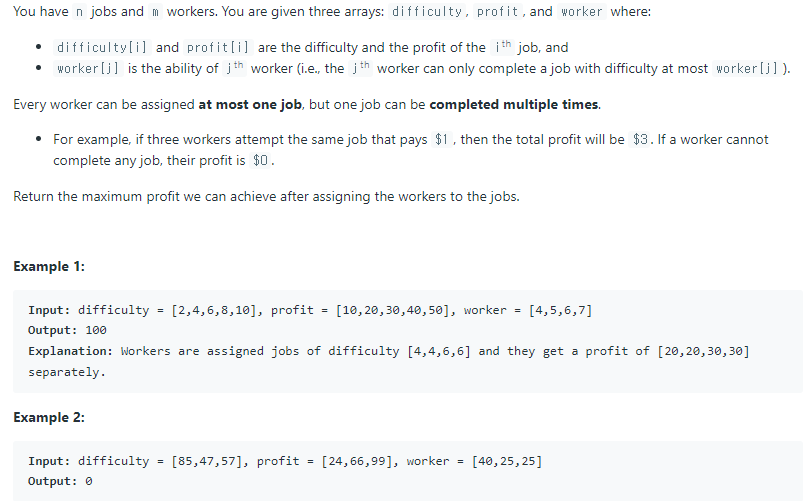

[https://leetcode.com/problems/most-profit-assigning-work/](https://leetcode.com/problems/most-profit-assigning-work/)

[Most Profit Assigning Work - LeetCode](https://leetcode.com/problems/most-profit-assigning-work/)



총 3개의 배열이 주어진다.

난이도, 이익, 작업자 이렇게 세 가지인데 난이도와 이익은 같은 인덱스일 경우 서로의 작업 난이도와 이익을 나타낸다.

worker배열은 해당 작업자가 얼마 큼의 난이도 있는 업무를 처리할 수 있는지 나타낸다.

\==풀이==

difficulty와 profit은 서로 관련 있는 데이터이기 때문에 정렬할 때 함께 정렬해주어야 한다.

둘을 묶어줄 배열을 만든 후 여기에 같은 인덱스를 가진 데이터끼리 묶어서 넣어준 후 sort() 메서드로 profit기준 내림차순 정렬한다.

이유는 profit이 높은 업무부터 체크해서 점차 다음 업무로 넘어갈 것이라서 내림차순으로 정렬하는 것이다.

정렬이 끝났다면 이번에는 worker를 내림차순 정렬해주는데 이는 ability가 높은 노동자부터 확인해서 difficulty가 낮은 업무 순으로 넘어가며 체크할 것이기 때문이다.

정렬한 difficulty-profit과 worker를 함께 체크한다.

업무의 난이도와 노동자의 능력치를 확인한 후

업무의 난이도가 더 높다면 다음으로 높은 이익인 업무를 확인하러 간다.

업무의 난이도가 더 낮다면 이미 이익으로 내림차순 정렬되어있기 때문에 현재 업무 이익이 노동자가 처리할 수 있는 최고의 이익을 가져다줄 업무이다.

정답에 추가해준 후 다음 노동자를 확인해준다.

```javascript
var maxProfitAssignment = function(difficulty, profit, worker) {
    let total = 0;
    const diffAndPro = [];

    // 1. 어려움과 이익을 묶어서 정렬할거임. 이익 높은 업무부터 체크해야함
    for(let i=0; i<profit.length; i++){
        diffAndPro.push([difficulty[i],profit[i]]);
    }
    diffAndPro.sort((a,b)=>b[1]-a[1]);

    // 2. 노동자의 능력내에서 가능한 일 찾기
    worker.sort((a,b)=>b-a);  // 능력 좋은 노동자부터 체크
    let jobIdx = 0;
    let workIdx = 0;
    while(jobIdx < diffAndPro.length && workIdx < worker.length){
        // 노동자 능력이 낮으면 다음 업무 확인하러
        if(worker[workIdx] < diffAndPro[jobIdx][0]){
            jobIdx ++;  // 아쉽지만 다음 업무 확인 ㄱㄱ
        }else{
            total += diffAndPro[jobIdx][1];  // 능력 내의 일이면 정답에 추가
            workIdx ++;  // 다음 노동자 확인 ㄱㄱ
        }
    }

    return total;
};
```
