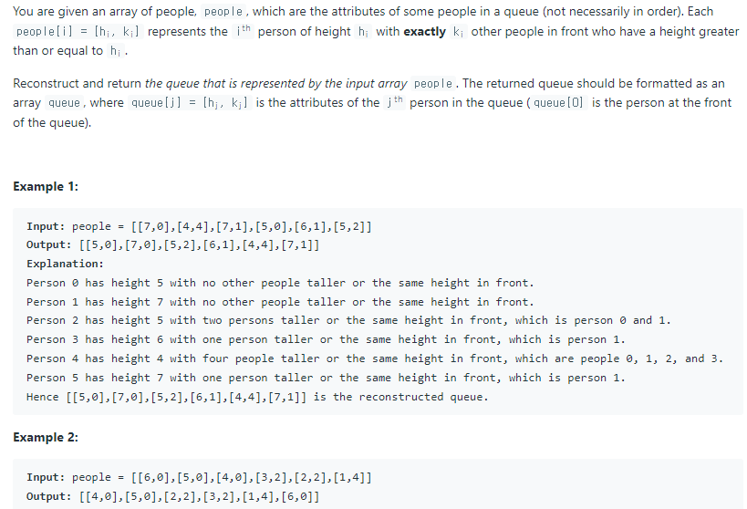

[https://leetcode.com/problems/queue-reconstruction-by-height/](https://leetcode.com/problems/queue-reconstruction-by-height/)

[Queue Reconstruction by Height - LeetCode](https://leetcode.com/problems/queue-reconstruction-by-height/)



문제가 길어서 복잡해 보이지만 Example을 보면 쉽게 이해할 수 있다.

이중 배열 각 요소중 \[0\]은 키를, \[1\]은 내 앞에 선 사람 중 나와 키가 같거나 큰 사람 수를 나타낸다.

이에 맞게 배열을 재 정렬해서 반환하면 된다.

첫 번째로 일단 people를 정렬해주어야 하는데 키 기준으로 내림차순 정렬하되 키가 같다면 \[1\]의 값인 내 앞사람 수로 오름차순 정렬한다.

그런 다음 splice를 이용해서 앞에 키 큰사람이 몇 명 있는지를 나타내 주는 \[1\]을 정답의 인덱스로 하여 그 위치에 꽂아준다.

왜 이렇게 되는지는 예를 들어보면 알 수 있다.

현재 \[\[7,0\], \[7,1\]\]의 상태일 때 추가해주어야 하는 다음 people이 \[6,1\]이라면 나보다 큰 사람이 1명이란 뜻이니까 정답의 1번 위치에 삽입되어야 할 것이다.

그래서 \[\[7,0\], \[6,1\], \[7,1\]\]의 상태가 되었고 그다음 people가 \[5,3\]이라 할 때 나보다 큰 사람이 3명이니 3번 위치에 넣어주면 맞는다.

\[\[7,0\], \[6,1\], \[7,1\], \[5,3\]\]이 되었고 마지막 people가 \[4,0\]이면 이 사람은 맨 앞에 들어가야 한다.

이런 식으로 내 앞에 키 큰 사람이 몇 명 존재하는지의 값이 곧 정답에 추가될 인덱스와 일치하게 된다.

```javascript
var reconstructQueue = function(people) {
    const sorting=(a, b)=>{
        if(a[0]==b[0]) return a[1]-b[1];  // 첫 값이 같으면 두번째로 정렬
        else return b[0]-a[0];  // 그외엔 첫값으로 내림차순 정렬
    }
    const answer = [];
    people.sort(sorting);

    for(const p of people){
        answer.splice(p[1], 0, p);  // 앞에 몇명 있는지 데이터를 인덱스로해서 추가해줌
    }

    return answer
};
```
