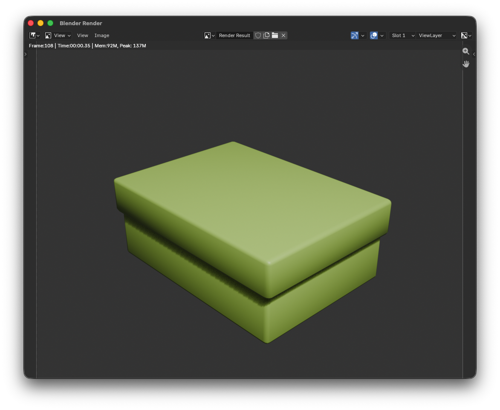
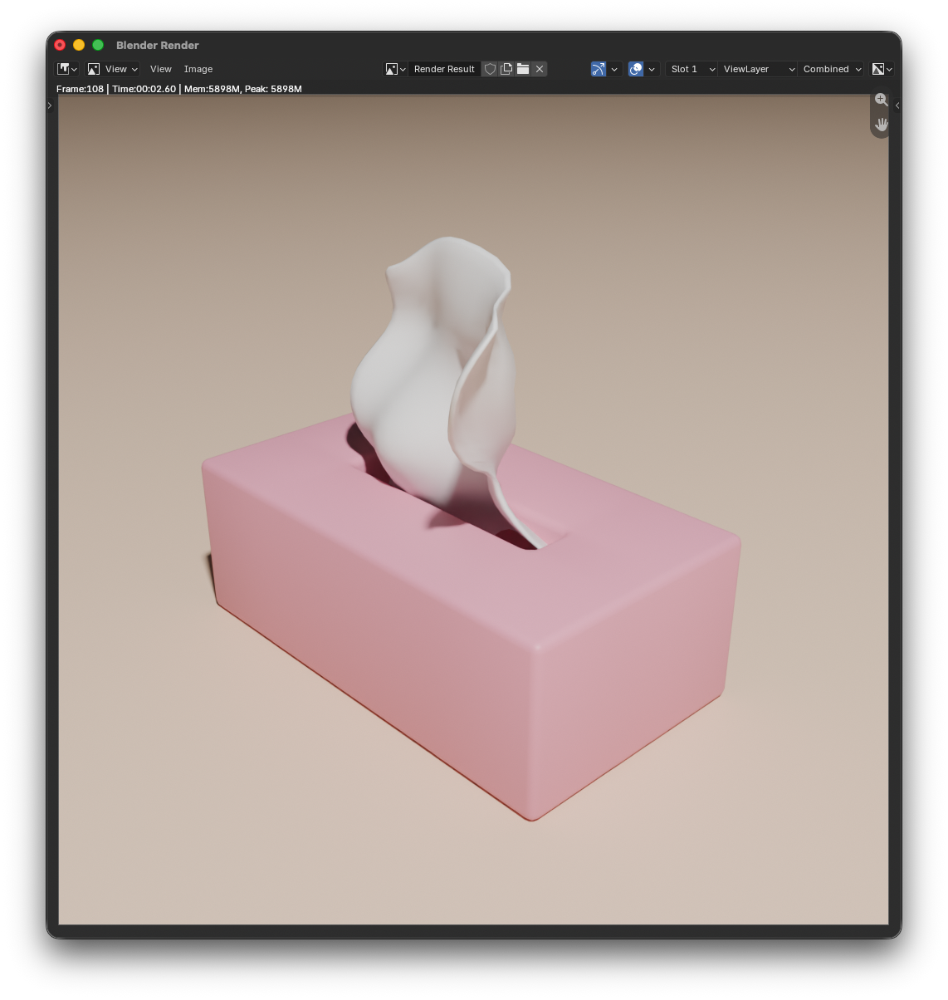
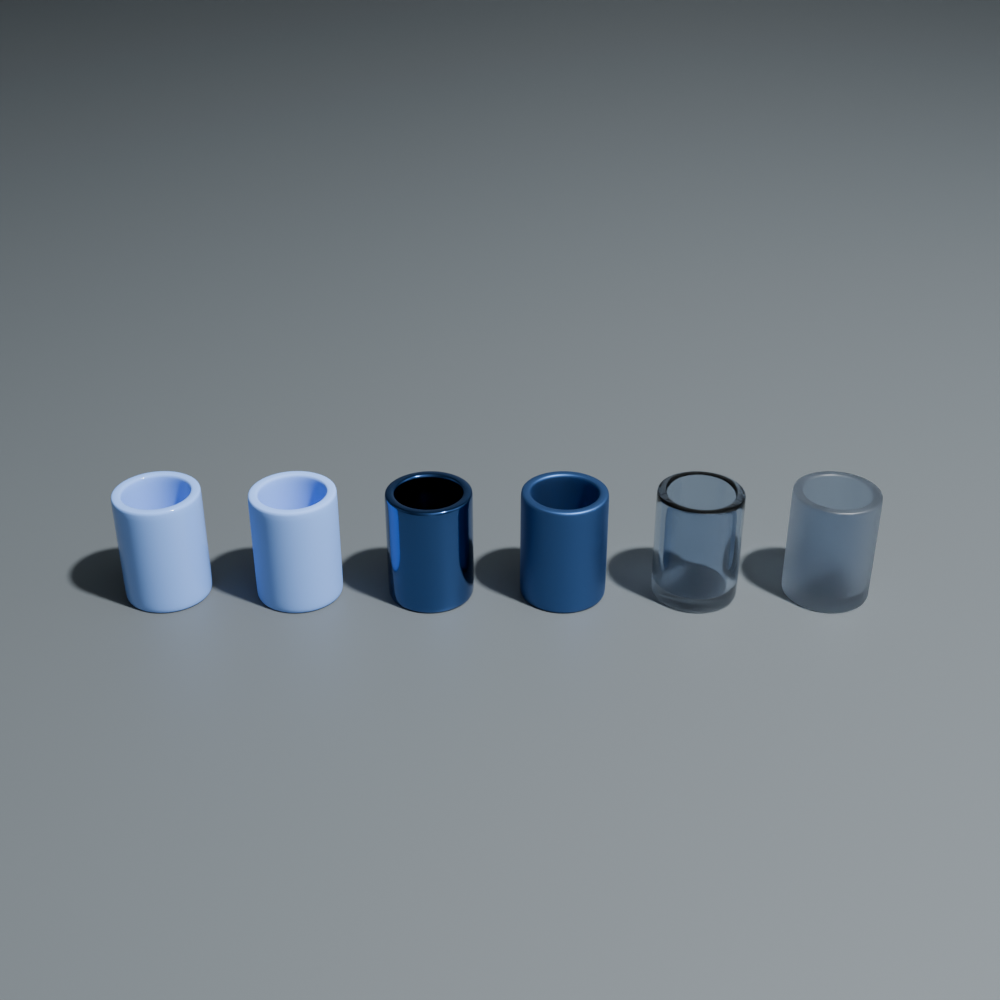

## 단축키

* 뭔가 조절하는 기능들은 x, y, z를 누른채 마우스 드래그하면 해당 축으로만 조절 가능하다.

### 1. 기본 조작

- Tab: object ↔  edit 모드전환

- F2: rename

- n: Side Bar(오른쪽 바) 토글

- Shift + d: 물체 복사. 상단 메뉴 Mesh - Duplicate 의 단축키

- Shift + r: Repeat Last. 가장 최근에 한 행동 반복.

- shift + a: Add. 상단의 add 메뉴를 현재 커서위치에 열기

- ctl + j: Object - Join의 단축키. 물체 하나로 합치기

### 2. 모양 변경

- s: 스케일. 누르고 숫자를 쓰면 상세 스케일 조정도 가능.

- e: 익스트루드. 물체를 늘리거나 줄이거나

- i: 인셋. 오브젝트의 안쪽으로 외곽선 복사?

- ctl + b: 베벨=모서리 둥글리기. 휠로 둥글리는 정도를 조절할 수 있다. 하는도중 c 누르면 클램프 적용 on/off 가능
* 베벨한걸 더 부드럽게 처리하고 싶으면, Object Mode → 우클릭 → Shade Auto Smooth(현재는 Shade Flat)

- loop cut(루프컷): Crtl + r

  - 루프컷 실행하고 휠 돌리면 컷 개수 증가

  - 한번 클릭하면 개수 확정되고 그때 esc나 마우스 우클로 균등 분배

- f: 상단 메뉴에서 Vertex - New Edge/Face from Vertices. 선에서 면을 채우기

### 3. 위치 변경

- r: rotate

- g: 오브젝트 이동

### 4. 선택

- a: 전체선택

- l: 오브젝트 전체를 선택하고 싶으면 edit mode 에서 마우스 오버 한 상태로 l 누르면 전체 선택된다.

---

## 도구

- 상단 바 중 과녁같이 생긴거: 프로포셔널 에디팅. 켜면 비율에 따라 메쉬 조정 가능

- 섭디젼 서페이스: 도구모양 아이콘 -> 새로운 모디파이어 생성 -> Generate -> Subdivision Surface 추가. 추가하고나면 Apply를 해줘야 최종 반영됨

## 1. normal-green-box

1. Plane Mesh 생성
2. 스케일 조정 후 익스트루드로 상자 모양 만들기
3. 윗면 선택 후 인셋 & 아래쪽 익스트루드해서 내부 공간 만들기
4. 2단계로 베벨
5. 1~4에서 만든 상자를, 복사 -> 크기 키우기 ->180회전 -> 길이 줄이기로 뚜껑 만들어줌
6. 기본 텍스처로 색상만 입혀준 뒤 완료

## 2. facial-tissue

### 휴지곽
1. Plane Mesh 생성
2. 스케일 조정 후 익스트루드로 상자 모양 만들기
3. 루프컷 2줄을 가로 세로 각각 추가해서 휴지 구멍 만들기
4. 3에서 만든 휴지구멍 선택해서 내부로 익스트루드
5. 베벨

### 휴지
1. Plane Mesh 생성
2. 90도 회전해서 위치 잡기
3. 가로 세로 각각 10개씩 루프컷
4. 기즈모에서 Y로 고정하고(생략 가능) 프로프셜 에디팅 켜고 휴지처럼 모양 잡기
5. 섭디비전 서페이스로 메쉬 잘게 만들기

### 조립
1. 휴지곽+휴지를 join해서 하나로 만들어줌
2. 각각 알맞는 재질 적용해준 뒤 완료

## 3. Cup

1. Circle 메시 추가(꼭지점 16)
2. 선들로 면 만들기
3. 컵 비율로 익스트루드
4. 윗면 인셋 -> 아래쪽 익스트루드
5. 4번 상태에서 바로 섭디비전 서페이스
6. 5번에서 만들어진 모양 다듬기 위해 루프컷. 겉면과 안쪽면 원통 아래쪽에 추가. 바닥면과 안쪽바닥면은 인셋 2번 추가.
7. 원하는 재질로 입혀준뒤 완료