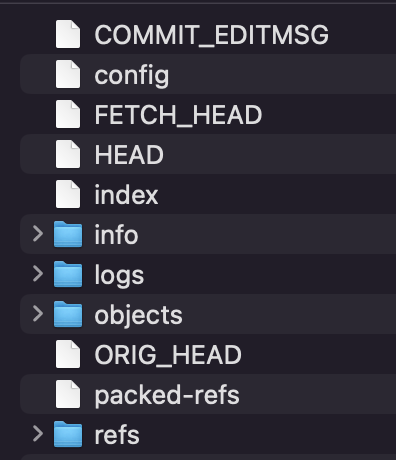

프로젝트를 생성하여 이를 Git 저장소로 관리하고 싶을 때 `git init` 명령어를 사용한다.

이때 `.git` 폴더가 자동으로 생성된다.

이 `.git` 폴더에는 어떤 정보가 담겨 있을까?

## **1\. `.git` 폴더**

`.git` 폴더는 Git 저장소의 핵심이 담겨있는 곳이다.

폴더 안의 주요 구성 요소를 살펴보자.



**HEAD**

-   현재 체크아웃된 브랜치를 가리킴
-   `cat .git/HEAD`로 현재 체크아웃된 브랜치 확인 가능

**config**

-   저장소의 Git 설정을 저장하는 파일
-   원격 저장소 주소, 사용자 정보, 커스텀 설정 등

**logs/**

-   브랜치 및 HEAD의 변경 이력을 기록하는 디렉토리
-   `git reflog` 명령어로 확인 가능

**objects/**

-   Git의 핵심 데이터인 커밋, 트리, 블롭 등을 저장하는 디렉토리
-   모든 파일과 커밋이 압축된 형태로 저장됨
-   주요 하위 디렉토리:
    -   objects/info/ : 객체에 대한 추가 메타데이터 저장
    -   objects/pack/ : 객체들을 하나의 패키지 파일로 저장하여 최적화

**refs/**

-   브랜치 및 태그 정보 저장되는 디렉토리
-   주요 하위 디렉토리:
    -   refs/heads/ : 로컬 브랜치 참조. 로컬 브랜치들이 가리키고 있는 커밋 해시를 저장
    -   refs/remotes/ : 원격 브랜치 참조
    -   refs/tags/ : 태그 참조

위에 objects/pack/ 설명 중에 **"객체"**라는 단어가 등장한다.

여기서 **"객체"**가 무엇인지 자세히 알아보자.

## **2\. Git 객체**

Git에서 object란 Git 이 내부적으로 데이터를 저장하는 기본 단위이다.

Git의 버전 관리를 위한 핵심 요소들이 객체로 저장된다.

Git은 변경된 파일 관리, 커밋 만들기, 브랜치를 추적하는데 필요한 모든 데이터를 객체 형태로 다룬다.

이 객체의 유형은 크게 4가지가 있다.

**Blob (Binary Large Object)**

-   내용: 파일의 실제 내용(파일 자체)
-   용도: Git은 파일의 이름이나 메타데이터는 저장하지 않고 파일의 내용만 저장한다. 파일의 이름에 관한 데이터는 '트리'객체에서 관리
-   예시: 텍스트 파일, 이미지 파일 등 모든 종류의 파일 내용
-   설명: Git은 파일의 내용만 해싱하여 블롭 객체를 관리한다.

**Tree**

-   내용: 디렉토리 구조를 나타냄
-   용도: 디렉토리에 대한 정보를 트리 구조로 저장. 트리는 파일이나 다른 트리 객체를 가리키는 포인터를 포함한다.
-   예시: dir1/, dir1/file.txt 같은 디렉토리 및 파일 구조를 나타내는 객체
-   설명: 트리 객체는 다른 트리 객체와 블롭 객체를 참조해서 파일이나 서브 디렉토리를 구성한다.

**Commit**

-   내용: 특정 시점의 Git 프로젝트 상태를 저장. 커밋 객체는 해당 커밋이 참조하는 트리 객체와 부모 커밋, 커밋 메시지, 작성자 정보 등을 포함
-   용도: Git의 버전 관리에서 각 커밋이 어떤 상태였는지 추적하고 복원
-   예시: "Initial commit" ,"Fix bug in login function" 같은 커밋 메시지와 함께 저장됨
-   설명: 커밋 객체는 하나의 트리 객체를 참조하고, 해당 트리 객체는 그 커밋 당시의 디렉토리 구조를 나타낸다.

**Tag**

-   용도: 특정 커밋에 이름을 붙여서 쉽게 참조할 수 있도록 함.

> 💡Git 객체들이 파일로 압축되는 이유는?
> Git은 효율적으로 데이터를 관리하기 위해 객체를 패키지 파일로 묶어서 저장하는 방법을 사용한다.
> 이를 패킹이라고 부르고 .pack 파일은 여러 Git 객체들을 묶어서 하나의 파일로 저장한다.

## **3\. `git reflog`**

이 포스팅을 작성하려던 계기가 `git reflog`에 대해 알아보던 것이었는데, 결론부터 말하자면 `git reflog`를 통해 커밋을 잘못 reset한 경우에 되돌릴 수 있다.

`git reflog`는 간단히 말하자면 Git의 히스토리를 볼 수 있는 명령어이다.

Git에서 Reference Log를 보여주고 이를 통해 브랜치나 HEAD가 어떤 커밋을 참조했는지에 대한 이력을 추적할 수 있다.

특히 이전 HEAD 위치나 브랜치 이동 기록을 확인하려 할 때 유용하다.

`git reflog`를 실행하면 다음과 같은 형태의 로그를 볼 수 있다.

```shell
$ git reflog
a1b2c3d HEAD@{0}: commit: Update README
f1e2d3c HEAD@{1}: commit: Add new feature
e4f5g6h HEAD@{2}: checkout: moving from feature to main
d7h8i9j HEAD@{3}: commit: Fix bug in login
```

> 💡 HEAD@{n}
> n은 HEAD가 참조한 커밋의 순서를 나타낸다. HEAD@{0}은 가장 최근 커밋을, HEAD@{1}은 그 이전 커밋을 가리킴

`git reset`을 잘못해서 로컬에 있는 커밋을 날렸다면 당황하지 않고 `git reflog`를 통해 커밋 히스토리를 찾아 복구할 수 있다.

만약 HEAD@{2} 로 복구하고 싶다면 아래와 같이 명령어를 사용하면 된다.

```shell
git reset --hard HEAD@{2}
```

reflog는 커밋만 추적하는 것이 아니라 체크아웃, 리셋, 병합 등 여러 Git 작업을 모두 기록하기 때문에 필요에 따라 활용할 수 있다.

참고로 reflog 기록은 90일간 보존되기 때문에 이보다 과거의 기록은 볼 수 없다.

## **4\. 정리**

-   `.git` 폴더는 Git 저장소의 핵심 데이터를 담고 있음
-   Git 객체는 버전 관리를 위한 기본 단위
-   `git reflog`는 Git 히스토리 추적에 용이

Git의 내부 작동 원리를 이해하고 있으면 프로젝트와 버전 관리를 훨씬 효율적으로 할 수 있다.
