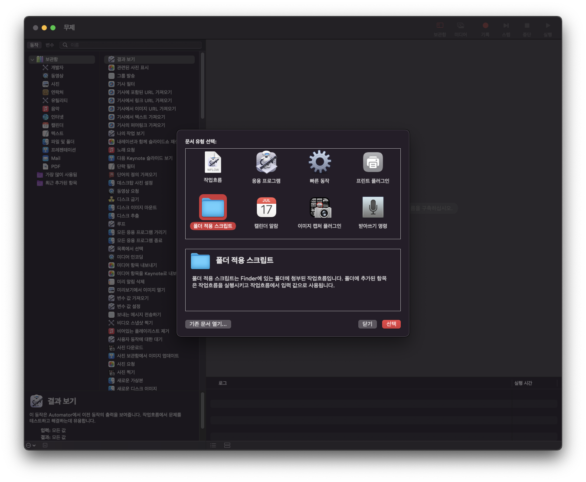
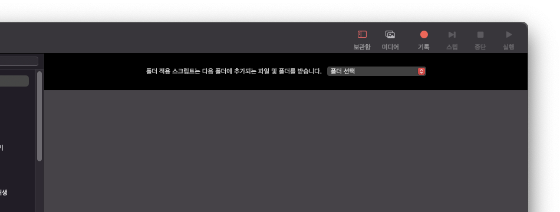
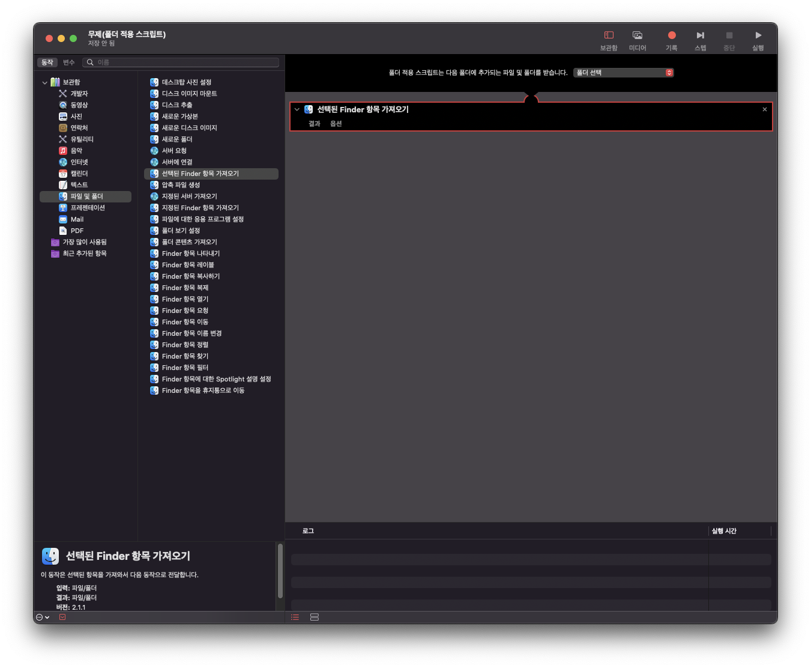
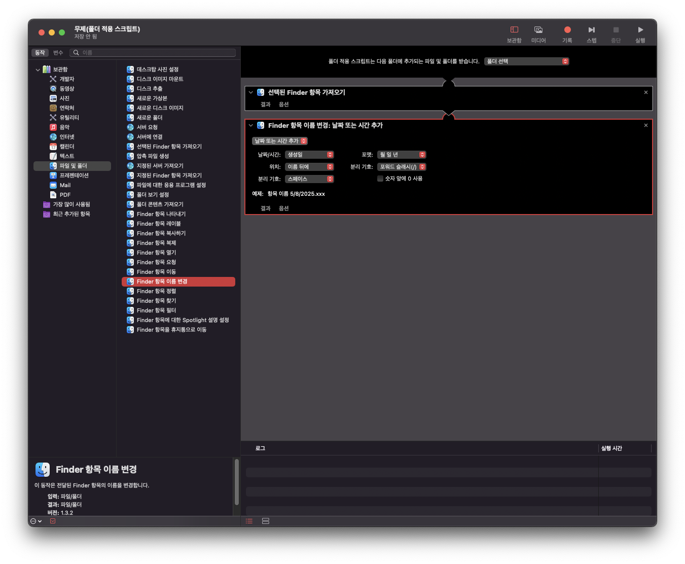
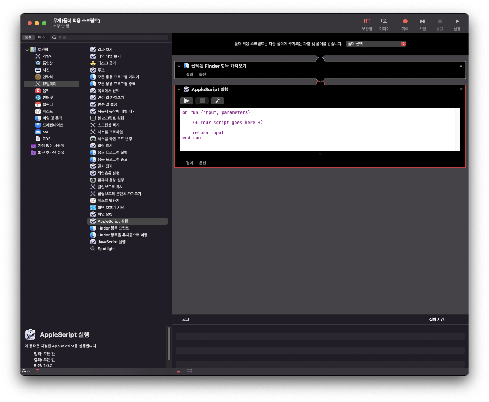
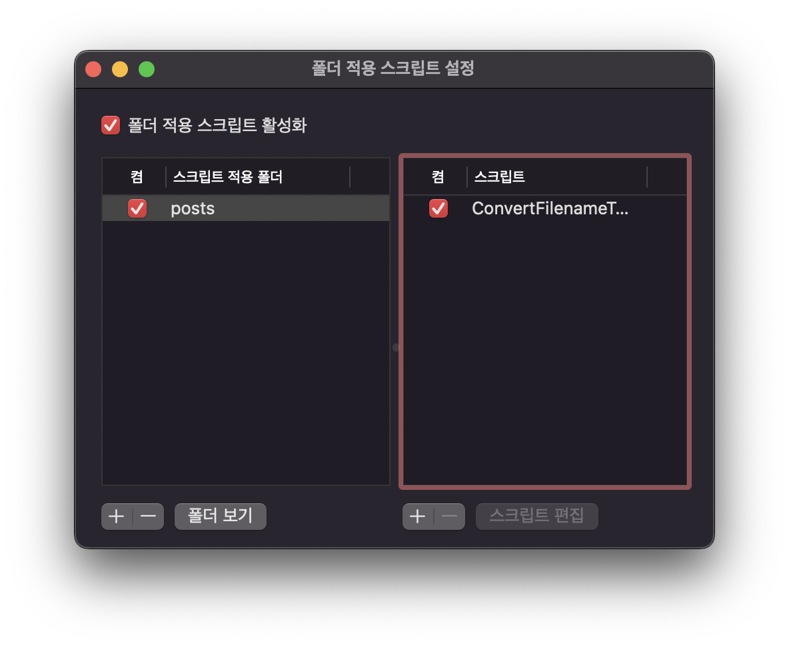
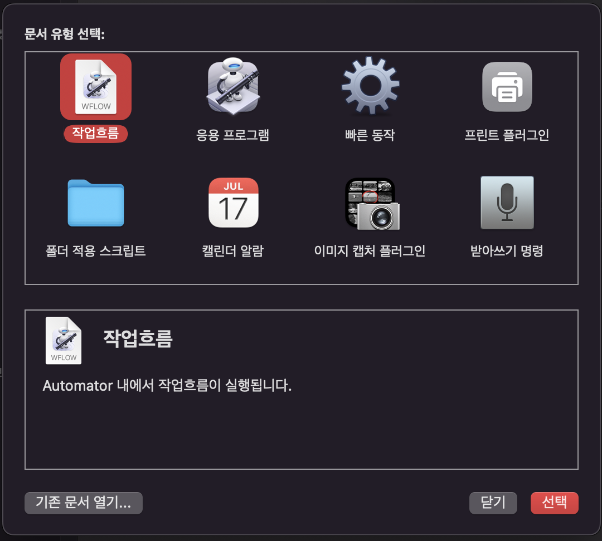
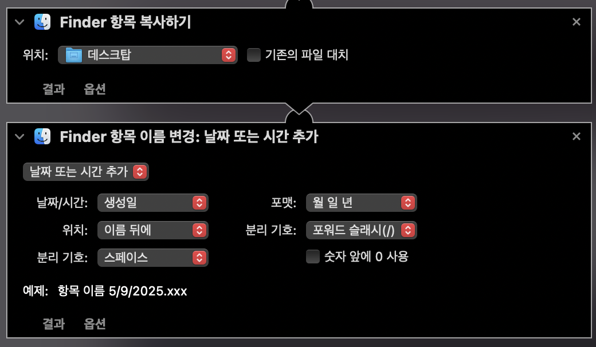
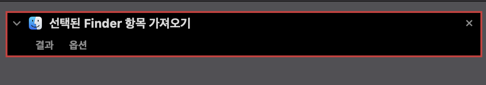

* * *

따로 개인 블로그를 만들면서 생긴 필요성인데, 게시글 소스 파일 이름을 작성한 날짜(=현재날짜)를 **yymmdd** 형식으로 사용하고 있었다.

노션에 글을 작성하고 export 한 파일을 글감 소스 폴더에 넣어주고 현재 날짜고 이름을 변경하는 작업을 수동으로 해주고 있었는데, 이게 은근히 번거롭다.

특히 현재 날짜로 파일 이름을 변경하는 게 귀찮아서 자동화할 수 있을까 찾아보았다.

맥북에서 제공하는 automator 기능을 이용하면 쉽게 구현할 수 있었다. (나는 삽질하느라 쉽지 않았지만..)

## 1\. Automator 실행

⌘ + Space → “Automator” 검색 후 실행

## 2\. 문서 유형 선택



**폴더 적용 스크립트**를 선택해서 새로운 작업을 만들 것이다.

참고로 **작업흐름**은 폴더를 계속 감시하고 있는 게 아닌, 사용자가 직접 실행하는 작업이다.

## 3\. 타겟 폴더 선택



폴더 액션을 적용할 폴더를 선택해 줄 것이다.

드롭 박스를 열어서 **'기타...'** 항목을 선택하고 감시할 폴더를 선택해 준다.

## 4\. 폴더에 추가된 파일 가져오기



이미지에 보이는 경로대로 '선택된 Finder 항목 가져오기'로 추가된 폴더를 알아내는 작업을 추가한다.

(더 정확히는 변경된 파일을 가져온다. 때문에 이름이 변경된 것도 감지한다.)

작업 추가는 왼쪽 목록에서 오른쪽 회색 영역으로 드래그하면 된다.

## 5-1. 파일 이름 변경하는 작업 추가

파일 이름을 까다로운 규칙으로 변경하지 않는 이상은 왼쪽 목록 중 'Finder 항목 이름 변경' 작업을 추가하여 그중에 원하는 설정을 하면 된다.



\* 'Finder 항목 이름 변경' 작업을 추가할 때 확인 창이 뜨는데, 잘 읽어보고 원하는 대로 선택해 주면 된다. 위 이미지는 선택 안 한 것.

하지만 나는 파일 이름을 완전히 날짜로 대체하고 싶었고, 선택할 수 있는 옵션 중에 해당하는 설정이 없었다.

## 5-2. 스크립트 추가

'Finder 항목 이름 변경' 작업에서 원하는 옵션을 못 찾은 경우 직접 스크립트를 작성하면 된다.



위 이미지처럼 '유틸리티 - AppleScript 실행' 작업을 추가하면 스크립트를 작성할 수 있는 공간이 생긴다.

흰 영역에 원하는 대로 코드를 작성해 주면 된다.

아래는 **파일 이름을 현재 날짜로 변경**하는 스크립트이다.

```bash
on run {input, parameters}
  -- 오늘 날짜 가져오기 (형식: yymmdd)
  set currentDate to do shell script "date +'%y%m%d'"

  repeat with anItem in input
    set itemPath to POSIX path of anItem

    -- 현재 파일 이름 가져오기
    set fileName to do shell script "basename " & quoted form of itemPath

    -- 이름이 이미 날짜 형식이면 무시
    if fileName starts with currentDate then
      -- 이미 변경된 파일이므로 건너뜀
      return input
    end if

    -- 확장자 추출
    set itemExtension to do shell script "basename " & quoted form of itemPath & " | awk -F. '{if (NF>1) print $NF; else print \"\"}'"

    -- 부모 폴더 경로
    set parentFolder to do shell script "dirname " & quoted form of itemPath

    -- 새 파일명 생성
    set newName to currentDate
    if itemExtension is not "" then
      set newName to newName & "." & itemExtension
    end if

    set newPath to parentFolder & "/" & newName

    -- 실제 파일 이름 변경
    try
      do shell script "mv " & quoted form of itemPath & " " & quoted form of newPath
    on error errMsg number errNum
      display dialog "오류: " & errMsg & " (코드: " & errNum & ")"
    end try
  end repeat

  return input
end run
```

## 6\. 파일 저장

⌘ + S 눌러 파일 이름을 지정하고 저장

\* 이렇게 등록한 작업은 **폴더 적용 스크립트 설정** 애플리케이션에서도 확인할 수 있다.



## 7\. 테스트

지정한 폴더에 아무 파일이나 넣어서 이름이 자동으로 오늘 날짜로 변경되는지 확인해 본다.

* * *

#### 삽질한 내용들...

1\. Automator를 만들 때, **작업흐름**으로 선택하고 만들어서 폴더 변경이 감지가 안되었다.



작업흐름으로 만들면 변경을 감지할 폴더를 선택하는 부분이 없었는데 그건 뒤에 나올 2번 항목 때문에 오해한 부분이 있어서 잘못된걸 더 늦게 알아챘다.

어쨌든 덕분에 작업흐름은 사용자가 직접 실행을 눌러줘야 돌아가는 작업이란 걸 알게 되었다.

2\. 감시할 폴더를 잘못된 곳에서 설정하고 있었다.

**Finder 항목 이름 변경**을 추가하면 확인창이 뜨면서 **Finder 항목 복사하기** 작업을 같이 추가하겠냐고 물어본다.

이때 추가하겠다고 선택하면 자동으로 아래처럼 두 가지가 추가되는데, 여기서 **Finder 항목 복사하기**의 '위치'를 감시할 폴더로 설정하는 건 줄 알았다.

분명 작업 이름이 이상하다고 생각했는데 왜 더 깊게 의심하지 않았을까..



3\. **선택된 Finder 항목 가져오기**를 안 했다.



이걸 추가해 줘야 폴더 내 추가되는 파일을 감지할 수 있는데, 작업을 만들고 저장하는 폴더에 자동으로 변경사항이 감지되는 줄 알았다.

...

위 삽질들 때문에 파일 이름에 무한으로 날짜가 추가된다거나, 지금 추가한 파일이 아닌 기존 폴더에 들어있던 파일들에도 이름 바꾸기가 전부 적용되어 버려서 파일 한 개만 남아있다거나(이름 중복되는 파일을 Mac에서 자동 제거해서..) 하는 상황을 겪었다.

그래도 이 경험 덕분에 다음에는 다른 기능을 더 잘 설정할 수 있을 것 같다.
